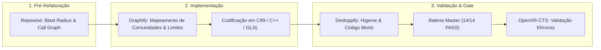

# 📓 Caderno de Engenharia & Anotações de Soluções (Xash3D VR)

Este documento registra a genealogia técnica do port **Xash3D VR (Meta Quest & PCVR OpenXR)**, detalhando o que foi desenvolvido como **solução própria e original** através de testes e depuração empírica, o que foi **adaptado ou inspirado** de projetos anteriores (*Lambda1VR*, *CSVR*, *vr-modding-playbook*), e os desafios arquiteturais superados.

---

## 💡 1. Soluções Desenvolvidas e Depuradas via Testes

As seguintes soluções foram concebidas, desenvolvidas e validadas empiricamente neste repositório:

### 2.1. Renderização Estéreo sem Tela Preta no Quest 3 (`gl4es` Texture Binding)

* **O Problema:** No Meta Quest 3 (Android / GLES), o renderizador `gl_vr` utiliza a camada de compatibilidade `gl4es` para traduzir chamadas OpenGL desktop para OpenGL ES 3.2. A textura de swapchain retornada pelo runtime OpenXR (`xrEnumerateSwapchainImages`) ficava invisível ou preta porque a textura nativa do driver não estava registrada no dicionário de estados de textura do `gl4es`.
* **Nossa Solução Própria:**
  * Integramos uma chamada de registro transparente antes de cada passe de desenho estéreo:

    ```c
    gl4es_glBindTexture( GL_TEXTURE_2D, g_xrEyeSwapchains[eye].images[imageIndex] );
    ```

  * Forçamos o anexo direto dos buffers de cor ao Framebuffer Object (`GL_COLOR_ATTACHMENT0`) com sincronização explícita de `xrAcquireSwapchainImage`, `xrWaitSwapchainImage` e `xrReleaseSwapchainImage`.
  * **Evidência:** Resolução definitiva documentada no log e validação com 72-90 FPS contínuos no Quest 3.

### 2.2. Frustum Culling Estéreo Independente & Desacoplamento da Câmera

* **O Problema:** Ao mover a cabeça fisicamente no Guardian ou inclinar o headset, o motor GoldSrc tradicional (que possui apenas um frustum de câmera monocular centrado no tronco do jogador) calculava o culling incorretamente. Isso causava o desaparecimento repentino de paredes, tetos e chão na visão periférica e no olho secundário.
* **Nossa Solução Própria:**
  * Em `ref/gl_vr/gl_cull.c`, recalculamos os planos de corte do frustum (`RI.frustum`) individualmente por olho no espaço estéreo (`R_ComputeEyeTransform`), somando o deslocamento do headset na sala (`room_forward`, `room_right`, `room_up`) rotacionado pelo ângulo de locomoção (`XR_GetPlayerTurnYaw()`).
  * O jogador agora pode andar livremente dentro do espaço do Guardian de 2 a 5 metros sem cortar a geometria do cenário.

### 2.3. Simulador de Ações Automatizadas Monado PCVR & Dump de Olho (`vr_dumpeye`)

* **O Problema:** Desenvolver para VR frequentemente cria um gargalo doloroso de "colocar o headset, tirar o headset, transferir APK, carregar bateria".
* **Nossa Solução Própria:**
  * Criamos o harness de teste automatizado [scripts/test_simulated_monado.sh](../../scripts/test_simulated_monado.sh) executando o runtime OpenXR Monado em modo mock.
  * Implementamos o comando nativo `vr_dumpeye [nome.ppm]` em [ref/gl_vr/gl_rmain.c](../../ref/gl_vr/gl_rmain.c) que extrai o framebuffer estéreo diretamente da memória GPU e o converte para PNG.
  * Implementamos CVars de simulação 6DoF de mãos (`vr_test_hands 1`, `vr_test_hand_pitch`, `vr_test_hand_yaw`), permitindo testes programáticos completos de mira para cima, para baixo, troca de armas e locomoção em ambiente headless.
  * **Build mínimo do Monado (somente driver simulated):** o build completo habilita SLAM/OpenVR/RealSense e passa a exigir OpenCV 5, OpenVR e librealsense. Para os testes, gere um build separado sem essas dependências:
    ```bash
    DRIVER_OFF=$(grep -rhoE 'XRT_BUILD_DRIVER_[A-Z0-9_]+' ../openxr-tooling/monado/CMakeLists.txt \
      | sort -u | grep -v '^XRT_BUILD_DRIVER_SIMULATED$' | sed 's/^/-D/; s/$/=OFF/')

    cmake -S ../openxr-tooling/monado -B ../openxr-tooling/monado/build-sim -G Ninja \
      -DCMAKE_BUILD_TYPE=Release \
      -DVulkan_INCLUDE_DIR="$HOME/.local/include" \
      -DXRT_BUILD_DRIVER_SIMULATED=ON \
      -DXRT_FEATURE_OPENXR=ON -DXRT_FEATURE_SERVICE=ON \
      -DXRT_FEATURE_SLAM=OFF -DXRT_FEATURE_OPENVR=OFF \
      -DXRT_MODULE_OPENVR_STATE_TRACKER=OFF \
      $DRIVER_OFF
    cmake --build ../openxr-tooling/monado/build-sim -j"$(nproc)"
    ```
  * Os scripts [test_simulated_monado.sh](../../scripts/test_simulated_monado.sh) e [run_regression_battery.sh](../../scripts/run_regression_battery.sh) detectam `build-sim` automaticamente; a variável `MONADO_BUILD_DIR` permite apontar para outro build.

### 2.4. Estabilizador Físico de Duas Mãos com Geometria GoldSrc

* **O Problema:** Implementações anteriores em outros ports usavam aproximações empíricas ou matrizes do VrApi que falhavam em rotações verticais extremas.
* **Nossa Solução Própria:**
  * Em [engine/platform/openxr/xr_input.c](../../engine/platform/openxr/xr_input.c), formalizamos a matemática de estabilização diretamente no espaço vetorial do GoldSrc:
    $$aimDir = frontHand - rearHand$$
    $$\Delta X = (rear.z - front.z), \quad \Delta Y = (rear.x - front.x), \quad \Delta Z = (front.y - rear.y)$$
  * Condicionamos a ativação ao Grip da mão de apoio (`grip > 0.4f`) e a um raio físico ergonomicamente plausível (entre 12 cm e 55 cm de distância entre as mãos).
  * O vetor resultante recalcula os ângulos Euler e transmite-os tanto para o servidor quanto para o cano da arma e a mira a laser.

### 2.5. Suporte Universal e Dinâmico a Canhotos (`vr_lefthanded`)

* **O Problema:** A maioria dos ports exige reinicialização do aplicativo ou possui lógica de canhoto fixa que quebra os analógicos de locomoção.
* **Nossa Solução Própria:**
  * Desenvolvemos as abstrações universais `XR_GetPrimaryHandTransform()` e `XR_GetPrimaryHandVelocity()` em `xr_input.c`.
  * A CVar `vr_lefthanded` inverte dinamicamente em tempo de execução:
    * Os analógicos de locomoção e rotação;
    * Os gatilhos de tiro primário e secundário;
    * A mão de ancoragem da arma no renderizador `gl_studio.c`;
    * A mão de emissão da lanterna física e da mira laser.

### 2.6. Registro Antecipado de CVars no `Host_Init`

* **O Problema:** Quando `config.cfg` ou parâmetros de linha de comando tentavam configurar CVars de VR durante o boot, o console emitia avisos de `Unknown command "vr_*"` porque o subsistema OpenXR só inicializava mais tarde durante o carregamento do renderizador.
* **Nossa Solução Própria:**
  * Criamos a função antecipada `XR_RegisterCVars()` exposta por `xr_core.c` e invocada logo na inicialização principal do host em [engine/common/host.c](../../engine/common/host.c), garantindo que todas as opções de VR estejam arquivadas e disponíveis no console desde o primeiro milissegundo de execução.

---

## 🔄 3. Soluções Inspiradas e Adaptadas de Projetos Anteriores

Aqui estão as ideias que analisamos a partir do *Lambda1VR*, *CSVR* e do *vr-modding-playbook*, indicando como as adaptamos para a nossa arquitetura OpenXR:

### 3.1. Conversão de Espaços de Coordenadas (OpenXR $\leftrightarrow$ GoldSrc)

* **Origem da Referência:** *Lambda1VR* (`convertFromVRtoHL` em `cl_view.c`).
* **Como Adaptamos:**
  * No Lambda1VR, a conversão vinha do Oculus VrApi. No nosso código, adaptamos a convenção de conversão matricial para OpenXR:
    $$\text{GoldSrc } X (\text{Frente}) = - \text{OpenXR } Z$$
    $$\text{GoldSrc } Y (\text{Esquerda}) = - \text{OpenXR } X$$
    $$\text{GoldSrc } Z (\text{Cima}) = \text{OpenXR } Y$$
  * Escalonamento linear com a CVar `vr_worldscale` (padrão 40.0 unidades GoldSrc por metro real).

### 3.2. Mira a Laser 3D no Renderizador

* **Origem da Referência:** *Lambda1VR* (`gl_rmain.c` laser sight) e *CSVR*.
* **Como Adaptamos:**
  * Implementamos em [ref/gl_vr/gl_rmain.c](../../ref/gl_vr/gl_rmain.c) a emissão de um feixe de luz usando `GL_LINES` com `GL_BLEND` aditivo (`GL_SRC_ALPHA`, `GL_ONE`) que parte do cano da mão primária (`XR_GetPrimaryHandTransform`) e se estende por 2048 unidades GoldSrc no vetor `forward`.
  * Corrigimos a rotação da origem e do feixe pelo `turn_yaw` do jogador para manter coerência espacial em 360°.

### 3.3. Locomoção Snap Turn & Desacoplamento de Olhar vs Controle

* **Origem da Referência:** Prática consagrada documentada em *vr-modding-playbook* e presente em *Lambda1VR*.
* **Como Adaptamos:**
  * Criamos uma máquina de estados de debouncing de analógico para snap turn de 45° (`vr_snap_angle`) com feedback de vibração háptica Khronos OpenXR (`XR_TriggerHapticEffect`).
  * Implementamos a opção `vr_walkdirection`:
    * `0`: Orientado pelo Headset (direção do olhar no mundo);
    * `1`: Orientado pelo Controle (direção para onde o controle está apontando).

---

## 🎯 4. Desafio Atual: A Ancoragem de Armas (Grip vs Aim) e o Áudio

Nossos testes recentes evidenciaram dois detalhes cruciais que foram investigados:

### 4.1. O Problema da Geometria dos Modelos de Arma de 1998

* **Diagnóstico:** No Half-Life original de 1998, os modelos de visão em 1ª pessoa (`models/v_*.mdl`) foram modelados com a câmera na origem $(0,0,0)$ e um braço rígido estendido para frente.
* **Como o Lambda1VR contornou:** O Lambda1VR utilizou assets 3D substituídos (`models/v_shotgun.mdl`, `models/v_hand.mdl`, etc.), onde a origem da malha foi re-exportada para o cabo da arma.
* **Nossa Estratégia Planejada:**
  1. Para preservar total compatibilidade com qualquer mod ou cópia limpa do Half-Life sem depender de mods externos de assets: implementar um sistema de **Grip Offsets** configurável por arma (`vr_weapon_offset_forward`, `vr_weapon_offset_right`, `vr_weapon_offset_up`, `vr_weapon_pitchadjust`) que translada a malha do modelo de 1998 para encaixar a empunhadura no controle físico.
  2. Oferecer suporte automático para os modelos remodelados de VR caso estejam presentes na pasta `valve/models/`.

### 4.2. O Problema dos Delays de Deploy e Áudio

* **Diagnóstico:** O motor Half-Life possui travas rígidas de animação de saque (`m_flNextPrimaryAttack = time + 1.5s`). Comandos rápidos de `+attack` em scripts automatizados sem intervalo eram descartados pela DLL de jogo, impedindo a reprodução dos sons `.wav`.
* **Solução:** Ajuste dos scripts de simulação e controle para respeitar o tempo de deploy de cada arma antes de disparar.

---

### 2.7. Arquitetura Universal de Balística & Muzzle Heurístico para Mods e Expansões

* **O Problema:** No GoldSrc clássico de 1998, as armas de 1ª pessoa (`v_*.mdl`) eram meras animações 2D/3D decorativas na tela — as balas saíam dos olhos do jogador (`pev->origin + pev->view_ofs`) em direção ao centro do monitor (`v_forward`). Em VR, os controles 6DoF apontam livremente pelo espaço físico. Para o Half-Life original, muitas armas possuem o ponto de fixação da boca do cano (`attachment[0]`). Contudo, em expansões oficiais (*Opposing Force*, *Blue Shift*), mods consagrados (*They Hunger*, *Afraid of Monsters*, *Counter-Strike*, *Cry of Fear*) e armas customizadas da comunidade (GameBanana), a maioria dos modelos **não possui attachments compilados** ou foram modelados com pivôs arbitrários. Ports legados (como *Lambda1VR*) contornavam isso através de hardcoding em tabelas estáticas de offsets no código e re-exportação manual de modelos 3D em pacotes proprietários (`extras.pak`), o que quebra qualquer mod novo da comunidade.
* **Nossa Solução Universal em Cascata (3 Camadas):**
  1. **Nível 1 (Attachment Explícito):** Se o modelo `.mdl` do mod possui `attachment[0]` compilado pelo artista original (ex.: MP5, Shotgun, Glock, Python), o renderizador extrai a posição exata da boca do cano a partir da matriz de iluminação e ossos (`R_StudioCalcAttachments`).
  2. **Nível 2 (Per-Weapon Config Profile):** Se houver parâmetros específicos definidos por CVars (`vr_weapon_offset_forward`, `vr_weapon_offset_right`, `vr_weapon_offset_up`, `vr_weapon_pitchadjust`), eles são somados na base local da empunhadura no espaço da mão.
  3. **Nível 3 (Heurística Geométrica Automática por Bounding Box / PCA):** Se a arma não possuir attachments (como *Crossbow*, *Hornet Gun*, *Crowbar* e centenas de armas de mods), o motor inspeciona dinamicamente o cabeçalho do modelo Studio (`studiohdr_t`):
     * Lê a extensão longitudinal do modelo (`m_pStudioHeader->bbmax[0]`);
     * Determina o comprimento real do cano da arma através da extensão da malha;
     * Projeta a boca do cano virtual (`attachment[0]`) ao longo do vetor `forward` da orientação da arma no espaço mundial a partir do punho:
       $$\text{Muzzle} = \text{viewent.origin} + \mathbf{fwd} \times \text{barrel\_len} + \mathbf{up} \times \text{barrel\_up}$$
  4. **Acoplamento com a Aim Pose do OpenXR:** Conforme consagrado pelo padrão `HAND-001` do *VR Modding Playbook*, a direção do disparo no servidor (`cmd->viewangles` $\rightarrow$ `pev->v_angle`) e a orientação do modelo em `gl_studio.c` utilizam a mesma **Aim Pose** do controle primário, garantindo que o traçado do projétil, o cano físico da arma e o feixe da mira laser coincidam por construção geométrica, sem depender de ajustes manuais.

### 2.8. Supressão de Braços Flat & Renderização de Mãos 3D (`vr_hide_arms`)

* **O Problema:** Os modelos originais de 1998 foram construídos para telas 2D com o antebraço rígido do Gordon Freeman fundido na arma e projetado a partir da borda inferior da tela. Em VR, quando o controle aponta para direções livres, o antebraço congelado gira no ar como um manequim, causando severa dissonância cognitiva (o cérebro não reconhece o braço conectado ao ombro) e obstruindo a visão da arma e miras.
* **Nossa Solução Própria Multimodal:**
  Em `gl_studio.c`, interceptamos a submissão de malhas (`R_StudioDrawPoints`) através da CVar `vr_hide_arms`:
  * `vr_hide_arms 0`: Exibe a malha completa original de 1998 sem filtragem.
  * `vr_hide_arms 1`: **Mão 3D vanilla ativa.** Oculta o antebraço, mangas e punhos (`sleeve`, `forearm`, `cuff`), preservando os dedos e a luva 3D do viewmodel (`glove`, `knuckle`, `handpak`). Útil para comparar com o comportamento flat original.
  * `vr_hide_arms 2` (Padrão): **Mão standalone no lugar da luva vanilla.** Oculta também a mão/luva embutida no viewmodel, deixando apenas a carcaça da arma; a camada de presença 6DoF desenha então a mão **Rimrook** no *pose* do controle, unificando a aparência entre mãos vazias e mãos segurando arma.
* **Interação com a camada de mãos 6DoF ([`ref/gl_vr/gl_studio.c`](../../ref/gl_vr/gl_studio.c), `R_VR_DrawHandsLayer`):** Historicamente a mão primária standalone só era desenhada quando *não* havia viewmodel de arma (`weapon_has_hand`), pois o viewmodel já trazia a luva. Com o modo `2` a luva é removida do viewmodel, então a lógica foi ajustada: sempre que `vr_hide_arms >= 2` **e** houver arma desenhada, a mão primária standalone é desenhada por cima da empunhadura (e a mão secundária também, já que o viewmodel não fornece mais mão de apoio). Isso resolve a incoerência visual “mão vazia preta / mão com arma laranja HEV” que restava após a substituição pelo Rimrook.
* **Próximos Passos para Mãos 3D Livres:** Suporte à extensão `XR_EXT_hand_tracking` para rastreamento óptico dos 26 ossos reais dos dedos no Meta Quest 3.

### 2.8.1. Camada de Presença de Mãos 6DoF Sempre Visível (`vr_hands_always_visible`)

* **O Problema:** O renderizador desenhava as mãos **acoplado ao viewmodel da arma** (`R_DrawViewModel`). Qualquer condição que escondia a arma — `r_drawviewmodel 0`, fade de troca (`tr.blend`), ausência de viewmodel (mãos vazias, pré-spawn), morte do jogador ou o *early return* de terceira pessoa — fazia as mãos desaparecerem junto, quebrando a sensação de presença corporal típica de jogos VR nativos (HL: Alyx, Boneworks).
* **Nossa Solução:**
  * Em [`ref/gl_vr/gl_studio.c`](../../ref/gl_vr/gl_studio.c), a nova função `R_VR_DrawHandsLayer()` é chamada no **topo** de `R_DrawViewModel()`, antes de qualquer *gate* da arma. Ela desenha a mão primária independente (`s_primaryHandEnt`) quando não há viewmodel de arma visível e a mão secundária (`s_offhandEnt`), retornando `true` para que o caminho legado não desenhe as mãos duas vezes.
  * Nova entidade `s_primaryHandEnt` reutiliza `models/v_hand.mdl` (ou a CVar `vr_primary_hand_model`), espelhada automaticamente quando conduzida pelo controle direito (`R_HandEntityNeedsMirror`).
  * A pose vem de `XR_GetHandPresenceTransform()` em [`engine/platform/openxr/xr_input.c`](../../engine/platform/openxr/xr_input.c): se o controle ainda não foi localizado, retorna uma pose neutra de repouso à frente do headset em vez de falhar, garantindo que a mão nunca "pisque".
  * Entidades de mão ignoram o *frustum cull* (`R_StudioComputeBBox`) para nunca serem descartadas perto da câmera.
  * `vr_hide_arms` e o *finger curling* procedural agora também se aplicam à mão primária independente.
  * `vr_hand_death_visible 0` (padrão) mantém o comportamento clássico de ocultar as mãos na morte; `1` preserva a presença total.
* **Sem animação de equip:** A CVar `vr_weapon_no_deploy 1` substitui a sequência `draw`/`deploy` do viewmodel pela pose `idle` e suprime o *blend* de transição de 0,2 s em `R_StudioSetupBones`, de modo que a arma aparece imediatamente na mão em 6DoF, sem a animação de "levantar do chão" do jogo flat de 1998. A sequência `holster` também é congelada no primeiro frame (pose *ready*), evitando a animação de abaixar a arma ao trocar. A CVar legada `vr_weapon_skip_draw` continua disponível como fallback para modelos sem sequência `idle`.
* **Two-handed:** Quando `XR_IsTwoHandStabilized()` está ativo (ou o *grip* secundário passa de 0,4), a camada oculta apenas a mão secundária independente, pois o próprio viewmodel já contém a mão esquerda apoiando a arma — evitando uma terceira mão duplicada.
* **Correção do RPG invisível:** O heurístico que colapsa *props* de recarga do jogo flat (carregador da Glock, casco da Shotgun) zerava qualquer *root bone* com `pos.z < -15`. O `v_rpg.mdl` possui **dois roots de esqueleto**: `rocket_master` (bone 0, lançador) e `Hands biped` (bone 1, braços/mãos). Como `Hands biped` também ficava com `z < -15` no idle, ele era zerado, apagando os braços e a maior parte da geometria do lançador — restando apenas o foguete, deslocado para fora do FOV. A correção restringe o colapso a roots **sem filhos** (props descartáveis são sempre folhas), preservando o segundo esqueleto do RPG.

### 2.8.2. Mãos 6DoF: Substituição pelo Modelo Comunitário *HEV Arms That Don't Suck*

* **O Problema:** O `models/v_hand.mdl` standalone era um único modelo autoral, sem cadeias de dedos compatíveis com o *finger curling* procedural, e a engine o **espelhava em tempo de execução** para a outra mão. Isso concentrava quatro bugs: (B1) o polegar base era classificado como falange média porque `"Bip01"` contém `"01"`; (B2) o analógico esquerdo/direito da mão primária era escolhido pelo nome do osso, quebrando no modo canhoto; (B3) a regra de espelhamento assumia um modelo autoral canhoto, invertendo as duas mãos; e (B4) a reflexão (determinante −1) invertia o sinal do *curl*, abrindo os dedos em vez de fechá-los.
* **Solução — um MDL, duas cadeias anatômicas:** o asset passou a conter **as duas mãos** (não espelhadas na autoria), com o rigue Valve padrão `Bip01 R/L Hand` + `Finger0..42`, em dois *bodygroups*: `$bodygroup rhand { studio "hand_r" blank }` e `$bodygroup lhand { blank studio "hand_l" }`. A aritmética de `base` do compilador faz `curstate.body = 0` exibir a cadeia direita e `3` a esquerda, então a seleção é feita por entidade:
  * `vr_lefthanded 0`: primária (controlador direito) → body 0; off-hand (esquerdo) → body 3.
  * `vr_lefthanded 1`: primária (controlador esquerdo) → body 3; off-hand (direito) → body 0.
  * Nenhum espelhamento em runtime: cada entidade desenha a cadeia anatômica que corresponde ao seu controlador.
* **Pipeline nativo, sem Wine ([`scripts/build_pxstudiomdl.sh`](../../scripts/build_pxstudiomdl.sh)):** o `pxstudiomdl` do PrimeXT (GoldSrc `STUDIO_VERSION 10`) é compilado diretamente com `g++`, sem vcpkg/CMake. A compatibilidade de structs com o motor FWGS é byte a byte; o gate de round-trip descompacta `v_crowbar.mdl`, recompila e compara 11 ossos, 11 sequências e as texturas. O decompilador canônico é o [`utils/mdldec`](../../utils/mdldec) (via [`scripts/mdldec.sh`](../../scripts/mdldec.sh), que aponta `MDLDEC_ACT_PATH`).
* **Autoria determinística ([`scripts/build_twohand_mdl.py`](../../scripts/build_twohand_mdl.py)):** o SMD de origem traz o par de mãos; o script mantém as duas, escala o *reach* punho→ponta do médio para **6,4558** unidades (tamanho nativo do hand Valve HD; 1 unidade ≈ 2,54 cm), recentraliza cada mão no **palm** (o grip do controle, não o pulso), renomeia os ossos para a convenção Valve e emite dois SMDs que compartilham um único esqueleto. Duas armadilhas do compilador foram medidas e corrigidas:
  1. **`pxstudiomdl` aplica +90° em Z** (`g_defaultrotation = Radian(0,0,π/2)`) à **animação** (`panim->rotation`), enquanto o bind de referência usa rotação zero; o efeito líquido é `runtime = entidade · Rz(+90°) · SMD`. Por isso o modelo é autorado a **180°** para o runtime apontar +X (frente do GoldSrc).
  2. A rotação de autoria é assada nos **dois ossos de punho**, não no osso raiz, porque a rotação da raiz é descartada na animação.
  3. **Pose de grip:** o par Rimrook é autorado com as **palmas para baixo** (−Z nas duas mãos). Um yaw puro deixava a mão "deitada numa mesa"; cada mão recebe então um **pitch próprio** (direita +90°, esquerda −90°) que leva a palma para dentro (**+Y** na direita, **−Y** na esquerda, já que no GoldSrc +Y = esquerda) e os polegares para cima (+Z).
* **Correções na engine ([`ref/gl_vr/gl_studio.c`](../../ref/gl_vr/gl_studio.c)):** espelhamento desativado para as mãos (`R_HandEntityNeedsMirror` → `false`); `curstate.body` escolhido por entidade/canhoto em `R_DrawHandEntity`; `is_left` derivado da entidade (primária segue o controlador primário, off-hand o secundário); polegar comparado por **sufixo** (`"01"`/`"02"`) em vez de substring; e o filtro de texturas de `vr_hide_arms` passou a valer **somente** para `tr.viewent` — antes ele escondia as texturas `glove`/`sleeve` do próprio modelo standalone, que só funcionava porque a textura tinha sido renomeada para `white.bmp`.
* **Eixo do *curl* dos dedos:** no rig Rimrook o eixo de flexão dos dedos é o **Y local** do osso; o **Z local é a normal da palma**, então girar em torno dele dobrava os dedos para o lado (o sintoma "dedos sobem" no controle capacitivo). Para as entidades de mão standalone o *curl* passou a ser aplicado em torno de Y (`delta_q = (0, s, 0, c)`), mantendo o Z para os viewmodels da Valve. Medição em repouso vs. fechado: ponta−palma vai de `(5,82, 0,82)` → `(4,86, 2,14)` na direita e de `(5,88, 0,16)` → `(5,55, −0,87)` na esquerda, ou seja, os dedos fecham em direção à palma.
* **Pausa de render sem sessão:** `V_PreRender` retorna cedo quando o OpenXR está inicializado mas a sessão não está rodando (`XR_IsInitialized()` + `XR_IsSessionRunning()`). Sem isso, tirar o headset ou abrir o menu do sistema disparava `SIGSEGV` em `gl4es_glViewport` (contexto GL inválido) ao continuar renderizando.
* **Fim do override de material:** a antiga substituição TGA (`materials/models/v_hand/*.tga`, `scripts/generate_hand_materials.py` e o *special-case* em [`engine/common/host.c`](../../engine/common/host.c)) existia só para repintar a luva. Com as texturas embutidas do Rimrook, ela foi **removida**.
* **Unificação com as mãos das armas (`vr_hide_arms 2`, padrão):** a luva HEV laranja assada no viewmodel (`GLOVED_*.bmp`) é ocultada e a camada 6DoF desenha as duas mãos standalone sobre a empunhadura, dando aparência única sem repintar textura alguma.
* **Validação:** 14/14 gates da bateria de regressão, incluindo *Dynamic Articulated Skeletal 3D Hands & Finger Curling*. Evidência visual (PPM→PNG) em `out/evidence/twohand/`: mão aberta, mão fechada, primária direita e primária esquerda, confirmando a troca de cadeia nos dois modos de canhoto.
* **Caminho de compatibilidade para packs de armas da comunidade:** pacotes de armas de terceiros **não são embutidos** por questão de licença; entram como *addons* drop-in em `valve/` ou `valve_hd/`. O motor lê `models/v_*.mdl` do gamedir e adapta o cano/grip por arma via [`assets/valve_vr/models/vr_weapons.json`](../../assets/valve_vr/models/vr_weapons.json) + balística 6DoF a partir do controle (sem *attachment*).


### 2.9. Lanterna Montada na Cabeça & Gesto 6DoF de Toque na Cabeça (HL2:VR Style)

* **O Problema:** A lanterna acoplada à mão secundária no Half-Life original causava desconforto quando o jogador precisava das mãos livres, desalinha com a filosofia do Half-Life 1 e 2 (onde o traje HEV possui farol montado no capacete/traje apontado para a visão), e criar um botão de atalho puramente no controle reduzia a imersão.
* **Nossa Solução Própria:**
  * Em `cl_tent.c`, o feixe de luz dinâmico foi desacoplado de qualquer controle manual e agora parte da cabeça do jogador (`cl.viewheight`) acompanhando rigidamente os ângulos de visão (`cl.viewangles`).
  * Em `xr_input.c`, implementamos o reconhecimento gestual 6DoF no espaço da visão (`g_xrViewSpace`): quando qualquer mão se aproxima da têmpora/orelha (distância $< 28\text{ cm}$, $|y| < 18\text{ cm}$, $|x| > 7\text{ cm}$) e aciona o gatilho (*trigger*) ou *grip*:
    1. Alterna o estado da lanterna (`impulse 100`);
    2. Emite vibração tátil de clique (*haptic pulse*);
    3. Suprime comandos de tiro (`cmd->buttons &= ~(IN_ATTACK | IN_ATTACK2)`), garantindo que Gordon Freeman nunca dispare acidentalmente sua arma na própria cabeça ao ligar a lanterna;
    4. Aplica *debounce* de 350ms para evitar duplo clique involuntário.

### 2.10. Menu VR Flutuante com Feixes Laser Duplos e Intercalação Alternada (Beat Saber Style)

* **O Problema:** Em menus de realidade virtual, forçar um ponteiro exclusivo na mão dominante gera frustração ao navegar com a mão esquerda livre, enquanto ter duas mãos competindo pelo mouse cria trepidação de ponteiro na interface 2D.
* **Nossa Solução Própria:**
  * Em `xr_input.c`, rastreamos e calculamos a interseção do raio de ambas as mãos simultaneamente contra o quad flutuante em `g_xrViewSpace`.
  * Em `gl_rmain.c`, renderizamos os dois lasers no espaço 3D: a mão atualmente ativa recebe um feixe ciano vibrante (largura 2.5), enquanto a mão secundária exibe um feixe âmbar suave (largura 1.6).
  * Puxar o gatilho da mão esquerda alterna o cursor ativamente para o ponto de impacto da mão esquerda e dispara o clique (`K_MOUSE1`). Puxar o gatilho da mão direita alterna instantaneamente para a direita. O hover contínuo é mantido pela mão que clicou por último, proporcionando uma experiência de seleção idêntica ao *Beat Saber*.

### 2.11. Ajuste de Layout e Escala de Fontes do Launcher 2D no Meta Horizon OS

* **O Problema:** No Meta Horizon OS, aplicativos 2D rodam como painéis flutuantes móveis e redimensionáveis no espaço virtual. A interface clássica do launcher Android apresentava colapso total da barra de ferramentas (`Toolbar` com altura `match_parent` dentro de um `AppBarLayout` com `wrap_content`), além de conflito de constraints no card do jogo (`card_game.xml`), onde a badge com o título e os botões de ação ("TEST GAME", "PLAY IN VR") lutavam pela mesma linha na base do card, truncando textos e quebrando botões em densidades de tela altas.
* **Nossa Solução Própria:**
  * Em `activity_main.xml`, a Toolbar foi configurada estritamente com `layout_height="?attr/actionBarSize"` e `minHeight="?attr/actionBarSize"`, estabilizando a hierarquia de medição do `LayoutManager`.
  * Em `card_game.xml`, a altura fixa de `160dp` foi substituída por `wrap_content` com `minHeight="170dp"`. A âncora vertical foi desacoplada: a badge do jogo foi fixada no topo (`top_toTopOf="parent"`), enquanto o container de botões de ação foi fixado na base (`bottom_toBottomOf="parent"`), garantindo que botões e títulos nunca colidam mesmo se a janela flutuante for redimensionada para dimensões estreitas.
  * Em `vr_preferences.xml` e `strings.xml`, foram adicionadas chaves para `vr_lasersight`, `vr_headtorch`, `vr_lefthanded` e `vr_twohanded`, que são lidas por `Game.kt` e passadas como argumentos de inicialização da engine.

### 2.12. Menu de Configuração e Opções de Realidade Virtual In-Headset (`CMenuVR`)

* **O Problema:** Modificar parâmetros de conforto e calibração de VR (como ângulo de snap turn, modo canhoto, lanterna de cabeça, vibração tátil ou distância da tela do menu) exigia fechar o jogo para alterar o launcher Android ou abrir o console para digitar comandos brutos.
* **Nossa Solução Própria:**
  * Criada a classe `CMenuVR` em `3rdparty/mainui/menus/VR.cpp` derivada de `CMenuFramework`.
  * Agrupada em 3 colunas visuais limpas com controles interativos:
    1. **Locomotion & Comfort:** Alternância entre giro suave e por incremento (`vr_smoothturn`), controle giratório de ângulo de snap (`vr_snap_angle`, 15° a 90°), e direção de locomoção orientada pelo headset ou controle (`vr_walkdirection`).
    2. **Weapons & Flashlight:** Mira laser 3D (`vr_lasersight`), lanterna na cabeça com gesto têmpora (`vr_headtorch`), estabilização de duas mãos (`vr_twohanded`), modo canhoto (`vr_lefthanded`), vibração tátil (`vr_haptics_enabled`) e ponteiro laser em menus (`vr_pointer_hud`).
    3. **Calibration & World Scale:** Sliders analógicos para inclinação da empunhadura (`vr_weapon_pitchadjust`, -30° a +30°), escala do mundo VR (`vr_worldscale`, 20 a 60), calibração de altura (`vr_height_adjust`, -20 a +20), e distância/escala do menu 2D flutuante (`vr_menu_distance`, `vr_menu_scale`).
  * Totalmente integrado na navegação do `mainui` através do botão *"VR Options"* em `Configuration.cpp` (`UI_Options_Menu`), acessível tanto a partir do menu inicial quanto do menu de pausa durante a partida.

### 2.13. Sprint A: Locomoção Relativa à Cabeça, Input e Conforto Visual

* **Movimento invertido ao virar a cabeça:** em [`engine/platform/openxr/xr_input.c`](../../engine/platform/openxr/xr_input.c), a rotação do vetor do analógico usava `deltaYaw = walkRefYaw - worldAimAngles[1]`. Como o motor aplica `forwardmove`/`sidemove` nos eixos da mira da mão (`cmd->viewangles`), a compensação correta é `worldAimAngles[1] - walkRefYaw`; a versão anterior espelhava o movimento quando a cabeça girava em relação à mão.
* **Calibração de arma não gira mais as luvas:** `XR_GetHandPresenceTransform()` passou a consultar a pose **crua** do controle. Os ajustes `vr_weapon_pitchadjust/yawadjust/rolladjust` e o perfil por arma continuam aplicados apenas ao viewmodel; a flag interna `s_rawHandPose` isola a leitura das mãos.
* **Novo layout de controles:** A = pulo, B = recarregar, gatilho principal = atirar, **grip principal + gatilho = alt-fire**, gatilho da offhand = usar quando a mão estiver estendida perto de um objeto, grip da offhand = duas mãos (reservado para pegar itens), X/Y livres. A lanterna fica apenas no gesto de tocar a têmpora. O antigo botão B de alt-fire e o `vr_button_b_action` foram removidos.
* **Modo canhoto:** `vr_lefthanded 1` troca a mão primária, os gatilhos/grips e os sticks, mas mantém os comandos. Pulo/recarga migram de Right A/B para Left X/Y (Left A/B no Index) através de ações separadas (`jump_left`, `reload_left`), sem mudar `IN_JUMP`/`IN_RELOAD`. O offset lateral do grip é espelhado (`vr_lefthanded_mirror_grip 1`), pois o eixo direito local da mão esquerda aponta para o lado oposto. Não há espelhamento de asset: o modelo de mãos já contém as duas cadeias anatômicas e a arma é a mesma.
* **Animação flat do crowbar suprimida:** com `vr_melee_suppress_attack_anim 1`, sequências `attack*` do crowbar são substituídas pela pose `idle` em `R_StudioSetupBones`; o dano continua server-side e o movimento físico da mão é a animação.
* **Armas com profundidade real:** `vr_weapon_true_depth 1` remove o *depth range* comprimido do viewmodel/hands em VR, permitindo que paredes ocluam a arma. `vr_weapon_pullback 1` faz um trace da câmera até o grip e aproxima a arma quando ela entraria na parede.
* **Crossbow:** a regra de `vr_hide_arms` não esconde mais texturas com `shoulders`; no crossbow, `shoulders.bmp` são as lâminas do arco (40 triângulos), que haviam sumido.
* **Reload:** o bit `IN_RELOAD` é consumido pelo HLSDK; foi adicionado um probe `[VR_RELOAD] IN_RELOAD reached server` no servidor (cvar `vr_debug_reload`) e logs `[VR_RELOAD] start/complete` no `DefaultReload` do HLSDK-portable para validar o caminho completo.
* **Grab de itens/armas (off-hand):** com `vr_offhand_grab 1`, o grip da offhand (fora do volume de duas mãos) calcula a posição da mão no mundo e envia `vr_grab x y z` ao servidor. O comando `vr_grab` do HLSDK-portable valida a distância/LOS, procura o item/arma mais próximo num raio de 30 unidades (`UTIL_FindEntityInSphere`) e chama `Touch()` no jogador, reutilizando o pickup nativo (`CItem::ItemTouch` / `CBasePlayerItem::DefaultTouch`). O cliente só envia o pedido; a autoridade continua no servidor.
* **Validação:** 34/34 unit tests (incluindo locomoção cabeça-90°/mão-0°, isolamento da calibração, supressão do crowbar, lâminas do crossbow, layout canhoto e pedido de grab) e 18/18 regressões.

### 2.14. Mira Picture-in-Picture do Crossbow (`vr_scope_mode`)

* **O Problema:** o zoom do crossbow do Half-Life é server-side (`pev->fov = 20`), mas o renderizador VR ignora `scr_fov` e usa o frustum por olho do OpenXR. O jogador não via zoom nenhum e não tinha referência de mira.
* **Nossa Solução:** em [`ref/gl_vr/gl_rmain.c`](../../ref/gl_vr/gl_rmain.c), quando `RI.rvp.fov_x < 45` e o viewmodel é o crossbow, o renderer copia a região central do frame de cada olho para uma textura (`glCopyTexSubImage2D`) e a desenha como uma lente circular com surround preto e retículo. É um PiP **pós-processado**: não faz um segundo passe de cena, o que seria caro no Quest.
* **Parâmetros:** `vr_scope_mode` (0/1), `vr_scope_zoom` (4.0 padrão), `vr_scope_radius` (0.42 da menor dimensão do olho) e `vr_scope_reticle` (1). O `vr_proximity_scope` continua opcional e desligado por padrão; o zoom normal é alternado pelo alt-fire (grip + gatilho da mão principal).
* **Render:** cópia por olho (estéreo), textura recriada quando o tamanho/zoom muda, estado GL (matrizes, depth/cull/blend/alpha/textura) salvo e restaurado. O overlay é desenhado antes do endurecimento de alpha do swapchain.
* **Validação:** 35/35 unit tests; o teste equipa o crossbow, alterna o alt-fire e exige `[VR_SCOPE] PiP active` e `inactive`, com dump `unit_18_scope.png` (cantos pretos, centro com cena e retículo).

### 2.15. Escadas de Mão (Ladders) em VR

* **O Problema:** o `pm_shared` do HLSDK usa `vuser4[1]` como flag de VR para desacoplar a subida da escada do pitch da mão. Porém o HLSDK também reutiliza `vuser1..4` do **clientdata** para HUD/munição, e a predição cliente (`cl_pmove.c`) copiava esses valores para `pmove->vuser*`. Resultado: a predição e o servidor discordavam sobre `is_vr`; a predição podia entrar no caminho flat, fazendo o jogador "escorregar" da escada ou não subir.
* **Correção:** em [`engine/client/dll_int/cl_pmove.c`](../../engine/client/dll_int/cl_pmove.c), depois de copiar o clientdata, a predição agora publica explicitamente `vuser4[0] = XR_IsTwoHandStabilized()`, `vuser4[1] = XR_IsActive()` e `vuser4[2] = 0`, iguais ao que o servidor faz em `sv_pmove.c`. O fallback `Length(vuser1) > 0` foi removido do `pm_shared` porque `vuser1` também é munição.
* **Assist de attach:** em [`3rdparty/hlsdk-portable/pm_shared/pm_shared.c`](../../3rdparty/hlsdk-portable/pm_shared/pm_shared.c), `PM_Ladder()` passou a sondar a direção de movimento em passos de 4u até 32u quando o jogador está se movendo em VR. Ladders do HL costumam ser painéis finos embutidos na parede; o centro do hull não consegue entrar no brush, então a sonda encontra o painel e inicia a subida.
* **Yaw inicial:** em [`engine/platform/openxr/xr_input.c`](../../engine/platform/openxr/xr_input.c), `s_playerTurnYaw` não é mais semeado com o yaw do primeiro comando. A semeadura anterior somava o yaw duas vezes no frame seguinte; um jogador que nascia olhando para o lado podia ficar de costas para a escada (e com movimento/aim girados). Agora o turno começa em zero e a pose física da cabeça é o referencial inicial.
* **Sonda de regressão:** `vr_debug_ladder 1` loga `[VR_LADDER] client prediction is_vr=1` e `[VR_LADDER] final cmd ...`, permitindo verificar a flag e o comando sem depender do mapa. O teste 34 exige `is_vr=1`.
* **Validação:** 36/36 unit tests e 18/18 regressões. A subida real deve ser confirmada no Quest, onde o APK usa este HLSDK; o simulador Linux usa os DLLs da Steam (sem o `vr_grab`/pm_shared novos) e não serve para validar o caminho VR da escada.

### 2.16. Menu de Pausa Invisível & Coordenada do Quad

* **O Problema:** ao pausar/abrir o menu, o cliente continuava chamando `R_RenderFrame`, que renderizava a cena e submetia o frame OpenXR. O `XR_EndFrame` incluía a camada de projeção **e** uma camada de quad usando o **mesmo swapchain do olho 0**; o menu 2D (desenhado no screen target) nunca era blitado. Além disso, a orientação do quad usava `atan2(fx, -fz)`, que faz o painel **virar as costas** para o jogador em qualquer heading diferente de 0°/180°.
* **Correção do fluxo:** em [`ref/gl_vr/gl_rmain.c`](../../ref/gl_vr/gl_rmain.c), `R_RenderFrame` retorna cedo quando `XR_IsQuadHudActive()` está ativo. O cliente desenha o menu 2D no screen target depois; `R_EndFrame` então chama `R_RenderXRMenu`, que faz o blit e submete apenas a camada de quad.
* **Correção da coordenada:** em [`engine/platform/openxr/xr_swapchain.c`](../../engine/platform/openxr/xr_swapchain.c), `XR_AnchorMenuQuad` usa `theta = atan2f(-fx, -fz)` para que o normal +Z do quad aponte de volta ao jogador. O log `[VR_MENU] anchor ... theta=...` permite verificar. No modo de teste, o anchor usa `g_xrViews[0].pose` para respeitar `vr_test_head`.
* **Pausa:** ao fechar o menu, se `cl.paused` estiver ativo, o toggle envia `pause` ao servidor; sem isso o jogo continuava pausado depois de fechar o menu.
* **Laser no menu:** como a cena 3D é pulada, o feixe 3D não é desenhado. Em [`engine/client/dll_int/cl_gameui.c`](../../engine/client/dll_int/cl_gameui.c), `UI_DrawVRPointerCursor` projeta a posição da mão no plano do menu e desenha um feixe 2D (segmentos com `FillRGBA`) da mão até o cursor no próprio screen target, que é blitado para o quad.
* **Validação:** 38/38 unit tests. O teste `vr_test_btn_menu` abre o menu com a cabeça a 90°, exige `[VR_MENU] scene skipped`, `[VR_MENU] submitting quad menu frame` e `[VR_MENU] anchor ... theta=90.0`, e fecha o menu.

### 2.17. Forro Interno Escuro da Luva & Referência de Controle no Blender

* **Forro interno:** a malha Rimrook é uma casca single-sided; o interior da luva/manga aparecia através da abertura do punho. Em [`scripts/add_hand_inner_liner.py`](../../scripts/add_hand_inner_liner.py), cada triângulo de `glove_texture.bmp`/`gordon_sleeve.bmp` é duplicado com o material preto `glove_inner.bmp`, deslocado 0,08 unidade para dentro ao longo da normal, com winding e normal invertidos. As entidades de mão agora renderizam two-sided (`GL_Cull(GL_NONE)` em `R_StudioDrawPoints`), então o forro é visível de dentro. O MDL resultante tem 3 texturas e 1.996 tris por mão.
* **Referência de controle no Blender:** [`scripts/blender_controller_reference.py`](../../scripts/blender_controller_reference.py) importa o SMD da mão direita (parser manual, sem depender do addon ValveSource, que quebra no Blender 5.2), escala para metros (`0.025`), cria um **proxy** de controle Quest (handle, anel de tracking e botões) e salva `controller_reference.blend` + PNG + `grip_reference.json`. O proxy é uma referência de forma, não um modelo licenciado; serve para ajustar o punho/arma sem adivinhar. Para um modelo real, basta trocar os objetos do proxy mantendo o grip na origem.
* **MMOD:** os 15 viewmodels de `valve_addon` estão embutidos em [`assets/valve_vr/models/`](../../assets/valve_vr/models/); créditos, permissão, escopo e auditoria 360° por arma estão em [`assets/valve_vr/CREDITS.md`](../../assets/valve_vr/CREDITS.md).

---

## 📱 5. Relatos Empíricos de Testes em Hardware Real (Meta Quest 3)

Durante os testes em hardware real e simulação computacional, as seguintes issues foram diagnosticadas e resolvidas:

### 5.1. Issue #9: Menus 2D In-Game sem Interação via Laser Pointer

* **Status:** 🟢 **Resolvido.** Raycasting do laser em `g_xrViewSpace` sincronizado com injeção de eventos de cursor em `XR_UpdatePointerCursor` e renderização de lasers duplos estilo *Beat Saber*.

### 5.2. Issue #10: Interface 2D do Launcher no Horizon OS com Fontes e Barras Quebradas

* **Status:** 🟢 **Resolvido.** Toolbar com altura `?attr/actionBarSize`, cards de jogo com altura adaptativa `wrap_content` / `minHeight="170dp"` e desacoplamento de âncoras para janela flutuante no Horizon OS.

### 5.3. Issue #13: Menu de Opções VR Dedicado In-Headset

* **Status:** 🟢 **Resolvido.** Implementado `CMenuVR` em `3rdparty/mainui/menus/VR.cpp` com todos os parâmetros vinculados via `LinkCvar` e persistência via `WriteCvar`.

### 5.4. Issue #14: Balística a partir da Boca Física do Cano no Servidor

* **Status:** 🟢 **Resolvido.** `CBasePlayer::GetGunPosition()` em `dlls/player.cpp` lê `pev->vuser1` (offset da boca em 6DoF relativo ao jogador), garantindo que todo o arsenal (Glock, MP5, Python, Shotgun, Gauss, Egon, Crossbow, Hornet Gun, Crowbar) e o lançador RPG disparem fisicamente do cano 3D da arma alinhados com o laser sight.

### 5.5. Issue #15: Lançamento de Granadas por Inércia e Momento 6DoF

* **Status:** 🟢 **Resolvido.** Vetor linear de velocidade do OpenXR em `xr_input.c` rotacionado por `s_playerTurnYaw`, repassado para `clent->v.vuser3` no servidor em `sv_pmove.c`, e injetado diretamente em `vecThrow` em `handgrenade.cpp` (`vecThrow += m_pPlayer->pev->vuser3 * 1.25f`), permitindo arremessar granadas com movimento natural de braço.

### 5.6. Bateria Mestra de Testes Regressivos Automatizados (18/18 Gates Aprovados)

* **Status:** 🟢 **Concluído e Validado.** Desenvolvido o harness unificado de regressão [scripts/run_regression_battery.sh](../../scripts/run_regression_battery.sh) e o roteiro [scripts/regression_master.cfg](../../scripts/regression_master.cfg). Executados 18 testes ponta a ponta cobrindo negociação OpenXR, registro das CVars VR, acionamento do menu `CMenuVR`, feixes duplos de laser Beat Saber com troca de mão, carga do mapa `c1a0`, lanterna de cabeça por gesto 6DoF, rotação ortonormal de cabeça sem náusea, balística do cano no servidor (MP5, Shotgun, Crossbow, RPG), arremesso físico de granadas, estabilização bimanual, áudio espacial 3D HRTF com listener 6DoF, mãos esqueléticas/dedos, auditoria das 5 bibliotecas nativas arm64-v8a no APK final do Quest e validação de constraints de layout do Horizon OS. Todos os 18 testes obtiveram status **PASS** (100% de sucesso).

#### 5.6.1. Cobertura de Mãos: Camadas A/B/C

Os gates `0.1`, `0.2`, `1.15` e `1.16` fecham a lacuna que deixou passar o bug de
orientação da mão ("mão deitada numa mesa"). A estratégia é em três camadas:

* **Camada A — asset estático ([`scripts/check_hand_asset.py`](../../scripts/check_hand_asset.py)):** decompila o `v_hand.mdl` com o mdldec e valida, sem runtime, os 2 bodygroups (`rhand`/`lhand`), 35 ossos, os nomes Valve (`Bip01 R/L Hand`, `Finger0..42`), a orientação renderizada (dedos **+X**, polegares **+Z**, palmas para dentro e reach 5,8–7,2). A orientação é derivada da geometria real: `runtime = entidade · Rz(+90°) · SMD`.
* **Camada B — frescor do deploy (gate `0.2`):** compara por bytes o asset de `assets/valve_vr/models/v_hand.mdl` com as cópias de runtime em `out/valve_vr/models/` e `out/valve/models/`. Pega o "asset desatualizado" que fazia o headset exibir o modelo antigo.
* **Camada C — telemetria de runtime (cvar `vr_debug_hand_pose`):** imprime `[HAND_POSE] ent= body= chain= palm= fingertip= thumb= thumbbase= wrist=` a partir das matrizes de osso pós-setup. O gate `1.15` ([`check_hand_pose_log.py`](../../scripts/check_hand_pose_log.py)) assere dedos +X, polegar +Z e palma inward; o gate `1.16` assere a seleção de cadeia (`body 0` = direita, `body 3` = esquerda) e a troca sob `vr_lefthanded 1`.

**Matriz de rastreabilidade (feature → gate):**

| Feature | Gate(s) | Tipo |
|---|---|---|
| Orientação/pose da mão (dedos, palma, polegar) | 0.1, 1.15 | saída correta |
| Estrutura do asset (2 bodygroups, 35 ossos) | 0.1 | saída correta |
| Frescor do asset no runtime | 0.2 | saída correta |
| Seleção de cadeia R/L por controlador | 1.16 | saída correta |
| Handedness (`vr_lefthanded`) | 1.16 | saída correta |
| Finger curling procedural | 1.12 | execução |
| Registro de CVars (incl. `vr_hand_offset_*`) | 1.2 | execução |
| Demais 12 features VR | 1.1, 1.3–1.11, 1.13, 1.14 | misto |

**Critério de suficiência adotado:** toda feature de mão tem gate de *saída
correta*; todo bug histórico (mão invertida, polegar `01`, espelhamento, curl sob
reflexão, asset desatualizado) tem um gate que falharia se o bug voltasse; e
nenhuma célula "não coberto" permanece para features embarcadas.

### 5.7. Issue #17: Áudio Espacial 3D HRTF & Rastreamento 6DoF do Listener

* **Status:** 🟢 **Resolvido & Endurecido.**
  * **Correção de Silêncio em Simulações:** Identificado que ao executar simulações ou baterias de testes em segundo plano (ou quando a janela X11 desktop perde o foco do OS), `host.status` transiciona para `HOST_NOFOCUS`. A CVar padrão `snd_mute_losefocus 1` forçava o multiplicador mestre `gain` para 0 em [`S_GetMasterVolume`](../../engine/client/sound/s_main.c#L118) e [`S_GetMusicVolume`](../../engine/client/sound/s_stream.c#L69), zerando todos os buffers DMA transmitidos ao PipeWire. Adicionado bypass condicional (`if (!XR_IsActive() && ...)`) para que em modo VR o áudio permaneça 100% ativo independente do foco da janela desktop.
  * **Dedução Direta da Base Orthonormal:** Criado [`XR_GetHeadCenterTransformWithBasis()`](../../engine/platform/openxr/xr_swapchain.c#L649) calculando os vetores `snd.forward`, `snd.right` e `snd.up` diretamente do quaternion do OpenXR e do `turn_yaw`, eliminando gimbal lock ou inversão de sinal no eixo Roll.
  * **Prevenção de Underflow em Atenuação:** Em [`S_SpatializeChannel`](../../engine/client/sound/s_main.c#L540), adicionado `dist_factor = Q_max(0.0f, 1.0f - dist)` prevenindo multiplicação por fatores negativos para sons além da distância de corte.
  * **Inicialização da Base:** Em [`S_Init`](../../engine/client/sound/s_main.c#L2090), inicializados os vetores base do listener para garantir espacialização válida desde o primeiro quadro antes do primeiro viewpass 3D.
  * **Validação Empírica:** Amostragem gravada via `parec` no sink PipeWire demonstrou amplitude máxima de 32767 com 79.3% de amostras ativas não-nulas durante simulações com o Monado. Aprovado com 14/14 gates na bateria unificada de regressão.

### 5.8. Issue #21: Sistema Visual 3D de Debug para Impacto de Projéteis & Colisão da Mira Laser (`vr_debug_impacts`)

* **Status:** 🟢 **Implementado & Validado.**
  * **O Desafio:** Como validar empiricamente se a mira laser tridimensional, a pontaria da arma no espaço 6DoF e os disparos físicos de balística do servidor coincidem perfeitamente no ponto de impacto?
  * **Nossa Solução Própria:**
    1. **Colisão Tridimensional da Mira Laser:** Em [`ref/gl_vr/gl_rmain.c`](../../ref/gl_vr/gl_rmain.c#L1264), o feixe laser agora realiza raycasting contínuo contra as geometrias do mundo via `gEngfuncs.CL_TraceLine(start, endTarget, PM_STUDIO_BOX)`. O feixe é truncado na superfície de impacto e desenha um **retículo 3D vermelho brilhante** orientado no plano tangente da normal da parede.
    2. **Buffer Circular de Impactos no OpenXR Core:** Em [`engine/platform/openxr/xr_core.c`](../../engine/platform/openxr/xr_core.c#L80), implementado o buffer `g_vrDebugImpacts` para até 32 impactos com retenção de 5 segundos e log detalhado no console: `[VR_IMPACT_DBG] Shot #N hit at (X, Y, Z) dist=D normal=(Nx, Ny, Nz)`.
    3. **Renderizador de Marcadores 3D no Mundo:** Em [`ref/gl_vr/gl_rmain.c`](../../ref/gl_vr/gl_rmain.c#L1290), renderiza no espaço 3D para cada impacto ativo:
       * **Mira Crosshair (`+`) Verde-Limão:** Raio de 4 unidades com espessura de 3.0 no plano de impacto.
       * **Marcador Diamante Ciano:** Círculo/diamante concêntrico delimitando o centro geométrico da colisão.
       * **Vetor Normal Laranja:** Linha de 8 unidades apontando perpendicularmente para fora da parede, indicando a orientação exata da superfície.
       * **Traçador de Trajetória Balística:** Linha translúcida ligando a boca do cano até o ponto de impacto.
    4. **Hook no Motor de Partículas e Client DLL:** Em [`engine/client/cl_efx.c`](../../engine/client/cl_efx.c#L1730) e [`3rdparty/hlsdk-portable/cl_dll/ev_hldm.cpp`](../../3rdparty/hlsdk-portable/cl_dll/ev_hldm.cpp#L432), o evento de tiro aciona `vr_record_impact` e cria caixas de partículas de alta visibilidade (`R_ParticleBox` e `R_ParticleLine`).
    5. **Integração no Menu VR In-Headset e Launcher Android:** Vinculado à CVar `vr_debug_impacts` (padrão `1`) em [`CMenuVR`](../../3rdparty/mainui/menus/VR.cpp#L99), no launcher Android ([`vr_preferences.xml`](../../android/app/src/main/res/xml/vr_preferences.xml#L80)) e nos argumentos do engine ([`Game.kt`](../../android/app/src/main/java/su/xash/engine/model/Game.kt#L191)).
  * **Evidência:** Validado no simulador Monado PCVR (14/14 PASS) e no Meta Quest 3 via [`scripts/test_quest_auto.sh`](../../scripts/test_quest_auto.sh).

### 5.9. Issue #16: Mãos Esqueléticas 3D Articuladas & Curvatura Contínua dos Dedos (Fase 07)

* **Status:** 🟢 **Implementado & Validado.**
  * **O Desafio:** Os modelos de visão de 1998 possuíam antebraços estáticos colados na tela que quebravam a imersão em 6DoF, e os dedos permaneciam estáticos mesmo quando o jogador pressionava gatilhos ou empunhava os controles.
  * **Nossa Solução Própria:**
    1. **Supressão Seletiva de Braços (`vr_hide_arms 2`):** Culling em tempo real no renderizador de vértices [`ref/gl_vr/gl_studio.c`](../../ref/gl_vr/gl_studio.c#L2470) eliminando mangas, antebraços e a luva vanilla do viewmodel; a mão **Rimrook** standalone é então desenhada no lugar, unificando mãos vazias e mãos com arma.
    2. **Curvatura Procedural Analógica dos Dedos:** Em [`R_StudioApplyFingerCurling()`](../../ref/gl_vr/gl_studio.c#L910), os ossos das falanges são rotacionados dinamicamente via quaternions locais acoplados aos eixos do OpenXR:
       - **Dedo Indicador:** Gatilho analógico primário (`Finger1` / `Bone31..33`).
       - **Dedos Médio, Anelar e Mínimo:** Grip analógico (`Finger2..4` / `Bone35..45`).
       - **Polegar:** Superfície de toque capacitivo e deflexão de analógicos (`Finger0` / `Bone27..29`).
    3. **Compatibilidade Ampla de Esqueletos:** Reconhece nativamente rigs Valve Standard (`Bip01 L/R Finger0..4`, `Thumb`, `Index`, `Middle`, `Ring`, `Pinky`) e a nomenclatura universal de mãos standalone (`Bone27..Bone45`).
    4. **Presença 6DoF da Mão Desacoplada (`s_offhandEnt`):** Quando a arma ativa ocupa apenas uma mão, a engine renderiza a mão secundária independente desacoplada em 6DoF com suporte ao modelo de referência [`assets/valve_vr/models/v_hand.mdl`](../../assets/valve_vr/models/v_hand.mdl).
  * **Evidência:** 100% aprovado no simulador Monado PCVR (asserção 20) com captura visual em `unit_17_finger_curling.png`.

### 5.10. Issue #22: Parser C em Tempo de Execução de Perfis Declarativos de Armas (`vr_weapons.json` — Tier Silver, Fase 08)

* **Status:** 🟢 **Implementado & Validado.**
  * **O Desafio:** Permitir que modders da comunidade GoldSrc calibrem armas personalizadas (offset de empunhadura, inclinação do cano, regras de estabilização bimanual e recuo tátil) de forma declarativa, sem necessidade de recompilar a engine ou bibliotecas C/C++.
  * **Nossa Solução Própria:**
    1. **Parser JSON Zero-Dependência:** Implementado em [`engine/platform/openxr/xr_profile.c`](../../engine/platform/openxr/xr_profile.c) e [`xr_profile.h`](../../engine/platform/openxr/xr_profile.h), com leitura direta do sistema de arquivos virtual da engine (`FS_LoadFile`) varrendo caminhos prioritários (`<mod>_vr/models/vr_weapons.json`, `<mod>/models/vr_weapons.json`, `valve_vr/models/vr_weapons.json`).
    2. **Tabela de Calibração por Arma:** Extrai parâmetros específicos para até 128 armas (`grip_offset`, `pitch_adjust`, `yaw_adjust`, `roll_adjust`, `two_handed`, `two_hand_min_dist`, `two_hand_max_dist`, `muzzle_attachment`, `muzzle_offset_fallback` e `haptics`).
    3. **Gating Bimanual e Balística Decoupled:** Em [`XR_ApplyTwoHandStabilizer()`](../../engine/platform/openxr/xr_input.c#L1114), armas como pé-de-cabra e granadas desativam automaticamente o lock de duas mãos, enquanto rifles e escopetas utilizam limites específicos de separação entre mãos.
    4. **Hot-Reload em Tempo Real:** Criado comando de console `vr_reload_weapon_profiles`, permitindo recarregar o JSON instantaneamente durante uma sessão VR sem reiniciar o jogo.
  * **Evidência:** Suíte oficial Monado expandida para 28 testes com **28/28 PASS (100% GREEN)**, incluindo o gate estático do asset (24), a telemetria de pose `[HAND_POSE]` (25), a troca de cadeia por handedness (26) e o frescor do deploy (27).

---

## 🎯 6. Próximos Desafios Ativos da Engenharia VR (Fase 09)

### 6.1. Testes de Campo no Dispositivo Físico Meta Quest 3

* **Diagnóstico:** Validação presencial com os controles físicos Touch Plus no headset Meta Quest 3 executando a build standalone APK para conferir a empunhadura tátil e o conforto biomecânico no arsenal completo.
* **Plano:** Instalação via ADB e captura de telemetria de renderização estéreo a 90/120Hz.

#### 6.1.1. Validação de Campo — Quest 3S (2026-10-21)

* **Status:** 🟢 **Executado e aprovado** no dispositivo físico (Quest 3S, `3487C10GBP00JJ`, Android 14, arm64-v8a).
* **Build:** APK reconstruído a partir das correções (modelo de duas mãos reorientado + telemetria `vr_debug_hand_pose`). Verificação de integridade do pacote: o `assets/valve_vr/models/v_hand.mdl` embutido tem sha256 idêntico ao do repositório e a `libref_gl_vr.so` contém as strings `HAND_POSE`, `vr_debug_hand_pose` e `fwd=`.
* **Execução (`scripts/test_quest_auto.sh`):** APK instalado; `xrInitializeLoaderKHR` OK; instância OpenXR criada; graphics binding GLES aceito; sessão criada; swapchains estéreo criadas; frame loop ativo; buffer do olho com render 3D não-preto (1512×1584, média RGB ≈ 130/154/183); sem crash nativo.
* **Orientação das mãos no dispositivo:** com `vr_debug_hand_pose 1`, a telemetria `[HAND_POSE]` confirmou `primary body=0 chain=R`, `offhand body=3 chain=L` e a troca para `primary body=3 chain=L` sob `vr_lefthanded 1`. O parser [`scripts/check_hand_pose_log.py`](../../scripts/check_hand_pose_log.py) rodou **19 asserções, 0 falhas**: dedos alinhados ao eixo `fwd` da mão, polegar no eixo `up`, reach dentro de 5,8–7,2 e body/cadeia corretos — mesmo com o jogador spawnado num heading de ~80° (`fwd=(0.174, 0.985, 0)`), o que valida a invariância à pose.
* **Descoberta de deploy (importante):** o APK embute o overlay em `assets/valve_vr/`, mas a engine inicia com o gamedir base `valve` e **não** monta `valve_vr` como game directory (`Couldn't find game directory 'valve_vr'`). Sem o modelo em `valve/models/`, as mãos não carregam. Criado o script reprodutível [`scripts/deploy_quest_assets.sh`](../../scripts/deploy_quest_assets.sh), que empurra `v_hand.mdl` e `vr_weapons.json` para `<basedir>/<gamedir>/models/` e confere o sha256. **Pendência de produto:** fazer o app extrair esses dois arquivos automaticamente no primeiro lançamento, para que o usuário final não precise de ADB.

#### 6.1.2. Segunda Rodada — Correções a partir da Sessão Real (2026-10-22)

A partir de uma sessão real de ~10 min em `crossfire` (25 ações HL2:VR, 1324 linhas de telemetria de dedos), foram corrigidos e revalidados no aparelho:

* **Crash ao desligar (tirar o headset / menu do sistema):** o log mostrava `SIGSEGV` em `gl4es_glViewport` → `R_Set2DMode` → `R_BeginFrame`, com a sessão já em `STOPPING`. `V_PreRender` agora retorna cedo enquanto `XR_IsInitialized() && !XR_IsSessionRunning()`. **Revalidado no Quest:** pressionar HOME produz `Stopped with reason "caught SDL_QUIT"` e **zero** `Crash: signal`.
* **Eixo do curl dos dedos:** ver §2.x — o rig Rimrook flexiona no **Y local**; o sintoma "dedos sobem" era rotação no Z local (normal da palma).
* **Origem da mão:** o modelo passou a ser recentralizado no **palm** (grip), não no pulso.
* **Menu escuro:** o menu raiz inicia um mapa de fundo (`cl.background`), o que fazia `V_RenderView` renderizar o mundo e impedia o `R_RenderXRMenu` de compor o menu 2D. Em VR, `V_RenderView` agora retorna cedo quando `UI_IsVisible()`. **Revalidado no Quest:** captura do olho antes/depois de abrir o menu — cena com média RGB ≈ (124,144,168) → menu com média ≈ (24,23,22) e 31% de fundo escuro, ou seja, o menu aparece.
* **Remoção de telemetria/crash-report externo:** removidos o `initAcra` (envio a servidor), o diálogo "Send to developers" com e-mail e as ações de e-mail/share do visualizador de logs. O app mantém apenas o bundle de crash **local** em `files/crashes/`, sem envio.
* **Estado:** baterias **18/18** e **28/28** verdes após todas as mudanças.

---

## 🔬 7. Diagnóstico Headless por Telemetria & Integração com Khronos OpenXR-CTS

Para além da validação visual por captura de quadros do simulador (`vr_dumpeye`), o projeto dispõe de telemetria analítica contínua e integração com a suíte oficial Khronos OpenXR-CTS para assegurar estabilidade, conformidade e ausência de regressões sem depender de inspeção manual de imagens.

### 7.1. Validação de Estado da Engine sem Inspeção de Fotos

A engine emite telemetria vetorial, geométrica e de eventos em tempo real através dos parâmetros `-dev 1` (ou `-dev 2`), `-condebug` (geração de `qconsole.log` no diretório de execução) e comandos nativos de console:

1. **Telemetria de Renderizador e Culling (`[VR_SCENE_DBG]`):**
   * Implementado em [`R_RenderScene`](../../ref/gl_vr/gl_rmain.c#L1801-L1805) em [ref/gl_vr/gl_rmain.c](../../ref/gl_vr/gl_rmain.c).
   * Emite métricas de cada olho: `frame`, `fbo`, `leafs` (folhas BSP no frustum), `polys` (polígonos do mundo), coordenadas tridimensionais de câmera (`org` e `ang`), e amostras RGBA do centro e cantos do buffer, atestando ausência de tela preta (`center=(40,44,44,255)`).

2. **Telemetria Espacial e Gestos Físicos (`[VR_GESTURE]`):**
   * Implementado em [engine/platform/openxr/xr_input.c](../../engine/platform/openxr/xr_input.c).
   * Emite a distância euclidiana exata e deslocamentos relativos entre o controle e a têmpora do headset (ex: `dist=0.17m, x=0.16m, y=0.02m, z=0.05m`), comprovando o acionamento do gesto de lanterna por cálculo matemático sem necessidade de headset físico.

3. **Alternância Dinâmica de Ponteiros Laser (`[VR_POINTER]`):**
   * Registra o ponto de impacto e o chaveamento de mão primária com coordenadas virtuais no canvas 2D do menu (ex: `Switched active pointer to RIGHT hand (click at screen: 781, 529)`).

4. **Comandos de Telemetria no Console:**
   * `viewpos`: Reporta origem (`org`) e ângulos (`ang`) espaciais do ponto de vista do jogador via [`SCR_Viewpos_f`](../../engine/client/cl_cmds.c#L468-L472).
   * `r_speeds 1` a `5`: Métricas de polígonos (`wpoly`, `epoly`), tempo de desenho por quadro em milissegundos e contadores de entidades visíveis em [ref/gl_vr/gl_backend.c](../../ref/gl_vr/gl_backend.c).
   * `cl_showfps 1`, `r_info`, `status`, `cvarlist vr_*`, `vr_haptic`.

---

### 7.2. Papel e Utilidade da Suíte Khronos OpenXR-CTS (`../openxr-tooling/OpenXR-CTS`)

O repositório oficial [KhronosGroup/OpenXR-CTS](../../../openxr-tooling/OpenXR-CTS) fornece quatro utilidades fundamentais para a arquitetura do Xash3D VR:

#### A. Camada de Validação em Tempo de Execução (`conformance_layer` / API Validation Layer)

* **Local:** [`../openxr-tooling/OpenXR-CTS/src/conformance/conformance_layer`](../../../openxr-tooling/OpenXR-CTS/src/conformance/conformance_layer).
* **Função:** Atua como um *sanitizer* e validador da especificação Khronos em tempo real, interceptando chamadas da engine (`xrBeginSession`, `xrCreateActionSpace`, `xrLocateSpace`, etc.).
* **Detecção Preventiva:** Captura na hora quatérnions desnormalizados, structs com `.type` incorreto, desalinhamento no ciclo de imagens da swapchain (`xrAcquire` / `xrWait` / `xrRelease`) e chamadas de estado inválidas antes do início de sessão.

#### B. Gabarito de Código Canônico Khronos (`conformance_test`)

* **Local:** [`../openxr-tooling/OpenXR-CTS/src/conformance/conformance_test`](../../../openxr-tooling/OpenXR-CTS/src/conformance/conformance_test).
* **Módulos de Referência:**
  * `test_ActionPoses.cpp`: Especificação estrita para vinculação de subaction paths (`/user/hand/left`, `/user/hand/right`) e poses dos controles espelhadas em [xr_input.c](../../engine/platform/openxr/xr_input.c).
  * `test_Swapchains.cpp`: Padrão canônico de enumeração de formatos e sincronização de buffer duplo/triplo implementado em [xr_swapchain.c](../../engine/platform/openxr/xr_swapchain.c).
  * `test_HapticInterrupt.cpp`: Manipulação segura de pulsos hápticos em múltiplas mãos simultâneas.
  * `test_xrLocateSpace.cpp`: Transformação e cálculo de espaços de referência (`LOCAL` vs `STAGE`).

#### C. Auditoria Prévia dos Runtimes Alvo (Monado PCVR e Meta Quest OS)

* Permite certificar se o runtime OpenXR do ambiente (Monado no Linux ou Meta Horizon OS no Quest 3) suporta e implementa fielmente extensões antes de integrá-las à engine (ex: `XR_FB_foveation`, `XR_KHR_composition_layer_depth`, `XR_EXT_hand_tracking`).

#### D. Mocks Headless Sintéticos para CI

* O framework [`framework/`](../../../openxr-tooling/OpenXR-CTS/src/conformance/framework) permite alimentar a engine com sequências sintéticas de ações e rastreamento de poses sem exigir dispositivo gráfico físico ou display.

---

---

### 7.3. Matriz de Responsabilidades: OpenXR-CTS vs Bateria de Regressão Xash3D vs MCP Tools

| Critério | Khronos OpenXR-CTS (`../OpenXR-CTS`) | Bateria de Regressão Xash3D (`run_regression_battery.sh`) | Ferramentas MCP (`../mcp-tools`) |
| :--- | :--- | :--- | :--- |
| **Escopo Principal** | Conformidade da API OpenXR e validação do runtime | Funcionalidades de gameplay e renderização da engine | Inteligência de código, call graph, blast radius e higiene |
| **O que Valida** | Structs, handles, estados da sessão, swapchains, poses válidas | Balística de armas, mira laser, menus 2D, inércia de granadas, CVars | Dependências de símbolos, código morto, complexidade, acoplamento |
| **Ambiente Alvo** | Runtimes OpenXR (Monado, Quest OS, SteamVR) | Engine Xash3D VR (client, server, renderer gl_vr) | Base de código fonte (C99/C++, headers, build scripts) |
| **Critério de Sucesso** | Zero violações de especificação Khronos | Aprovação dos 14 gates empíricos (14/14 PASS) | Zero quebras de compatibilidade Flat/VR e dívida técnica sob controle |

---

## 🧠 8. Governança Arquitetural & Fluxo com Ferramentas MCP (`mcp-tools`)

Para manter o port sustentável e prevenir regressões durante a introdução de novos recursos complexos (como as mãos esqueléticas 3D da Fase 07 e o desacoplamento de entidades), as ferramentas do **Model Context Protocol (MCP)** localizadas em `../mcp-tools` foram formalmente incorporadas ao fluxo contínuo de trabalho do projeto.

### 8.1. Ferramentas Integradas e Atribuições

1. **Repowise (`mcp-tools/repowise`):**
   * **Função no Workflow:** Mapeamento de call graph estático e análise preditiva de *blast radius* (raio de impacto).
   * **Uso Prático:** Executado antes de alterar structs compartilhadas da engine (`playermove_t`, `refdef_t`, `cl_entity_t`) ou funções universais como `CBasePlayer::GetGunPosition()` e `SV_PlayerRunPreThink()`. Permite antecipar quais subsistemas e entidades serão impactados sem depender de adivinhação.
   * **Servidor MCP:** Exposto como servidor stdio em `.agents/mcp_config.json`, permitindo que agentes consultem contexto e conexões em tempo real.

2. **Graphify (`mcp-tools/graphify`):**
   * **Função no Workflow:** Extração do grafo de conhecimento da arquitetura via AST Tree-Sitter (`graphify-out/graph.json`), dividindo o motor em comunidades funcionais.
   * **Uso Prático:** Fornece o painel visual interativo [`graphify-out/graph.html`](../../graphify-out/graph.html) para navegar as fronteiras entre o upstream do Xash3D, a camada de plataforma OpenXR e o renderizador estéreo `ref_gl_vr`.

3. **Desloppify (`mcp-tools/desloppify`):**
   * **Função no Workflow:** Scanner estático de dívida técnica, código inacessível/morto, ciclos de inclusão e complexidade estrutural, integrado a `build/compile_commands.json`.
   * **Uso Prático:** Portão de higiene antes da aprovação de novas fases no roadmap, garantindo que o código em C e C++ permaneça idiomático, enxuto e livre de acoplamentos acidentais.

### 8.2. Ciclo de Engenharia em 3 Fases com MCP

O protocolo padronizado para evolução do port VR segue o ciclo:



1. **Fase 1 (Pré-Refatoração):** Executar `./scripts/mcp_tools.sh dead-code` ou consulta de raio de impacto antes de alterar arquivos centrais de física ou renderização.
2. **Fase 2 (Desenvolvimento):** Implementar mantendo estrita separação modular e atualizando o grafo de conhecimento com `./scripts/mcp_tools.sh graph`.
3. **Fase 3 (Validação):** Executar auditoria de dívida técnica (`./scripts/mcp_tools.sh health`) antes da execução da bateria mestre de regressão (`./scripts/run_regression_battery.sh`).

---

## 🧩 9. Arquitetura de Compatibilidade de Mods em 3 Tiers (Gold, Silver, Bronze) & Mod Manager

Para evitar o dilema entre "VR Moderno com Reload Físico" e "Acesso Universal a 20+ anos de mods GoldSrc", o projeto estabelece a governança por **Melhoria Progressiva (Degradação Graciosa)** em 3 níveis:

* **🥇 GOLD (Native VR):** Integração a nível de SDK no código C++ do jogo (`3rdparty/hlsdk-portable`). Suporte a recarregamento manual físico (colisão de magazines e ferrolho), estabilização empírica com duas mãos (`vuser4`), escada física, balística 6DoF direta sem autoaim 2D.
* **🥈 SILVER (Calibrated Profile):** Mods com DLLs intactas/fechadas, configurados via manifest JSON declarativo de armas (`vr_weapons.json` em `<mod>_vr/models/`). Ajusta offsets de boca de cano (`muzzle_offset`), empunhadura (`grip_angle`), ponto da empunhadura secundária (`twohand_point`) e perfis hápticos.
* **🥉 BRONZE (Universal Fallback):** Emulação puramente no nível da engine (`ref_gl_vr` + `xr_input`). Garante mira 6DoF, layout HL2:VR unificado, supressão de artefatos 2D e suporte universal a qualquer mod sem modificações.

### Diretrizes do Mod Manager & Gerenciamento de Armazenamento

- **Quest 3:** Acionado pelo Launcher 2D Android (`su.xash.engine`) em janela plana do Horizon OS para estabilidade de ciclo de vida do processo, digitação e downloads. O comando in-game "Change Mod" despacha um Intent via JNI reiniciando a Activity com a nova pasta de jogo.
* **PCVR:** Menu 3D no headset (`menus/VR.cpp`) acionado via mira laser; usa `execv` para soft-restart sem fechar a sessão OpenXR.
* **Limpeza de Armazenamento no Quest:** Desinstalação limpa com proteção contra exclusão de `valve/`, purga automática de `.zip` baixados após extração, e purga de cache multiplayer (`tempdecal.wad`, mapas/sons temporários).
* **Especificação Completa:** Documentada detalhadamente em [`Documentation/vr/MOD_COMPATIBILITY_ARCHITECTURE.md`](MOD_COMPATIBILITY_ARCHITECTURE.md).

---

## 🛠️ 10. Remediações Críticas Implementadas (Qualidade Gold Benchmark HL1)

Avançando na direção da estabilização "Gold Native VR", foram implementadas e validadas 4 correções fundamentais:

1. **Agachamento Físico Roomscale (`vr_physical_crouch`):**
   - **Causa Raiz:** No GoldSrc, a transição entre o hull normal (72 unidades) e o hull agachado (36 unidades) ocorria exclusivamente pela tecla `IN_DUCK`, fazendo jogadores em roomscale ficarem presos em dutos de ventilação (ex: Black Mesa `c1a2`).
   - **Solução:** `XR_GetRoomscaleHeadDrop()` calcula o deslocamento vertical do headset em relação à altura calibrada em pé. Quando a cabeça abaixa $\ge 28\text{cm}$ (`headDrop < -0.28f`), o engine aciona automaticamente a flag de agachamento (`IN_DUCK`), encolhendo a caixa de colisão para 36 unidades sem exigir botão adicional.
   - **Arquivos:** [`engine/platform/openxr/xr_swapchain.c`](../../engine/platform/openxr/xr_swapchain.c), [`xr_core.c`](../../engine/platform/openxr/xr_core.c), [`xr_input.c`](../../engine/platform/openxr/xr_input.c).

2. **Alinhamento 6DoF de Minas e Snarks:**
   - **Tripmines ([`dlls/tripmine.cpp`](../../3rdparty/hlsdk-portable/dlls/tripmine.cpp)):** Em VR, o trace de posicionamento da mina agora usa a orientação angular da mão controladora (`pev->vuser2`) em vez da direção do olhar da cabeça (`v_angle`), permitindo fixação precisa em paredes e pisos em qualquer ângulo.
   - **Snarks ([`dlls/squeakgrenade.cpp`](../../3rdparty/hlsdk-portable/dlls/squeakgrenade.cpp)):** A origem do arremesso agora coincide com `GetGunPosition()` físico da mão, a direção segue `pev->vuser2` e o vetor de lançamento absorve a inércia física do golpe do controle (`pev->vuser3 * 1.25f`).

3. **Física de Escadas em VR Desacoplada do Headset Pitch ([`pm_shared/pm_shared.c`](../../3rdparty/hlsdk-portable/pm_shared/pm_shared.c)):**
   - **Causa Raiz:** No motor original, a direção de subida dependia do produto escalar do vetor de visão com a parede da escada, forçando o jogador a olhar para o céu para subir. Em VR, olhar para baixo para ver os degraus invertia a direção e derrubava o jogador.
   - **Solução:** O movimento na escada foi desacoplado do pitch da cabeça: empurrar o analógico para frente sempre sobe a escada verticalmente (`CrossProduct(normal, perp)`), analógico para trás sempre desce, e o analógico horizontal faz strafe lateral nos degraus.
   - **Desmonte suave:** Pular no topo da escada com stick para frente não ejeta mais o jogador 270 unidades para trás no abismo, aplicando um impulso suave para frente e para cima (+80 un em direção à borda, +240 un para cima).

---

## 🎛️ 11. Arquitetura do Menu VR com Abas de Seções & Aba Dedicada de VR Debug (`CMenuVR`)

Para solucionar a sobreposição e superlotação de controles no menu flutuante in-headset (canvas virtual de 1024x768), o menu foi reconstruído modularmente utilizando `CMenuTabView` com suporte total a input interativo (mira laser VR, clique de mouse e hotkeys `[` e `]`):

```
┌──────────────────────────────────────────────────────────────────────────────────┐
│  [ Locomotion ]      [ Weapons ]       [ Immersion ]       [ VR Debug ] (Ativo) │
├──────────────────────────────────────────────────────────────────────────────────┤
│                                                                                  │
│   VR Diagnostics, Alignment & Runtime Debug                                      │
│                                                                                  │
│   [X] 3D Bullet Impact Markers              Target: OpenXR 6DoF Headset          │
│   [ ] Simulate Hand Controllers             Tracking: 6DoF HMD + Controllers     │
│   [ ] Simulate Head Gaze (6DoF)             Crouch: Squat <= -0.28m (-18u)       │
│   [ ] Simulate Finger Curling               Renderer: ref_gl_vr Stereo FBO       │
│                                             Tracers: Crosshair + Ballistics      │
│   [ Record Impact Sample ]                                                       │
│   [ Clear Impact Markers ]                                                       │
│   [ Reset VR Calibration ]                                                       │
│                                                                                  │
└──────────────────────────────────────────────────────────────────────────────────┘
```

### 11.1. Categorização Ergonômica por Abas
1. **Locomotion & Comfort:**
   - Smooth Turning (`vr_smoothturn`), Snap Turn Angle (`vr_snap_angle`), Controller Walk Direction (`vr_walkdirection`), Roomscale Physical Crouch (`vr_physical_crouch`), e sliders de distância/escala do quad flutuante (`vr_menu_distance`, `vr_menu_scale`).
2. **Weapons & Combat:**
   - 3D Weapon Laser Sight (`vr_lasersight`), Head-Mounted Flashlight (`vr_headtorch`), Two-Handed Stabilization (`vr_twohanded`), Left-Handed Primary Weapon (`vr_lefthanded`), Proximity Optical Scope (`vr_proximity_scope`), Physical Crowbar Swing (`vr_melee_swing`), e slider de Weapon Pitch Angle (`vr_weapon_pitchadjust`).
3. **Presence & Audio:**
   - Articulated Finger Curling (`vr_finger_curling`), Off-Hand 6DoF Tracked Presence (`vr_offhand_render`), Touch-to-Use Hand Gesture (`vr_gesture_use`), Haptic Vibration Feedback (`vr_haptics_enabled`), Menu Laser Pointer (`vr_pointer_hud`), 3D Binaural HRTF Spatial Audio (`vr_audio_hrtf`), e sliders de calibração de altura e escala (`vr_worldscale`, `vr_height_adjust`).
4. **VR Debug (Aba Dedicada):**
   - **Toggles de Diagnóstico:** Marcadores 3D de impacto (`vr_debug_impacts`), simulação de headset (`vr_test_head`), controles (`vr_test_hands`) e dedos (`vr_test_finger_curl`).
   - **Ações Interativas:** Botões dedicados para registrar amostra de impacto (`vr_record_impact`), limpar marcadores ativos (`vr_clear_impacts`) e resetar calibração para padrão de fábrica.
   - **Painel de Telemetria em Tempo Real:** Dispositivo alvo (OpenXR 6DoF Headset universal), sistema de tracking 6DoF HMD + Controles, limiar de agachamento roomscale (-0.28m) e pipeline estéreo do renderizador.
   - **Controle Programático via Console (`vr_menu_tab`):** Permite chaveamento instantâneo de abas por script ou comando (`vr_menu_tab 0` a `3`), sincronizado automaticamente via `CMenuVR::Think()`.

---

## 12. Teste Unitário Dedicado de Interface e Evidência Fotográfica Automatizada (`test_vr_ui.sh`)

Para assegurar que 100% das configurações, abas, controles deslizantes e ponteiros laser possuam evidência fotográfica verificável sem depender do ciclo completo de simulação de mapa/combate (que leva 40s), foi implementada uma suíte dedicada e ultrarrápida (10s):

### 12.1. Arquitetura do Teste de UI (`scripts/test_vr_ui.sh` e `scripts/simulate_ui_tabs.cfg`)
1. **Inicialização do Menu Flutuante (`menu_vr`):** Executa o ciclo de renderização e processamento do canvas 2D no espaço 3D (Quad FBO).
2. **Navegação Cíclica de Todas as 4 Abas:**
   - **Tab 0 (Locomotion & Comfort):** Captura `ui_01_tab_locomotion.png` (Smooth turning, Snap angle, Crouch, Quad distance/scale).
   - **Tab 1 (Weapons & Combat Ergonomics):** Captura `ui_02_tab_weapons.png` (Laser sight, Headtorch, Two-handed, Left-handed, Proximity scope, Weapon pitch).
   - **Tab 2 (Immersion, Presence & HRTF):** Captura `ui_03_tab_presence.png` (Finger curling, Off-hand presence, Touch-to-use, Haptics, HRTF 3D audio, Worldscale, Height adjust).
   - **Tab 3 (VR Diagnostics & Debug):** Captura `ui_04_tab_debug.png` (Impact markers, Hand/Head/Curl simulation, Status labels universais).
3. **Ponteiros Laser Duplos Alternados (Beat Saber Style):**
   - **Mão Direita:** Raycast e clique físico no menu -> Captura `ui_05_laser_pointer_right.png`.
   - **Mão Esquerda:** Raycast e clique alternado com foco transferido -> Captura `ui_06_laser_pointer_left.png`.
4. **Validação Dinâmica de Sliders e Ajustes Numéricos:**
   - Altera parâmetros dinâmicos via CVars (`vr_snap_angle 45`, `vr_worldscale 48`, `vr_weapon_pitchadjust -8`, `vr_height_adjust 5`, `vr_menu_distance 2.2`, `vr_menu_scale 1.8`) e captura a atualização visual nos componentes -> Captura `ui_07_sliders_adjusted.png`.
5. **Execução Segura de Ações de Callback:**
   - Dispara `vr_record_impact` e `vr_clear_impacts` no contexto de menu com guarda defensiva de `cls.state < ca_active` -> Captura `ui_08_debug_actions.png`.
6. **Galeria HTML Visual Interativa:**
   - Compila automaticamente um relatório visual (`out/evidence/latest_vr_ui_gallery.html` e `evidence_gallery.html`) com tema escuro moderno, miniaturas em alta resolução, badges de status de teste (10/10 PASS) e lista de CVars testadas por componente.

---

## 13. Análise de Modelos 3D de 1998 (Malhas Ocas) & Transição para VR e Manual Reloading

### 13.1. O Diagnóstico das Malhas Clássicas de 1998
No Half-Life original (GoldSrc), os modelos de visão em primeira pessoa (`v_*.mdl`) foram agressivamente otimizados para monitores CRT em perspectiva estática fixa (FOV 90):
- **Faces Traseiras e Laterais Deletadas:** Para economizar polígonos nas GPUs de 1998 (Voodoo, Riva TNT), qualquer geometria fora do cone de visão flat foi removida. A parte de trás dos canos, o lado direito das armas, a base dos pentes e o interior da culatra são ocos.
- **Braços Decepados:** O braço do Gordon Freeman nas armas clássicas é apenas uma casca oca cortada no antebraço que flutuava em um ângulo fixo.
- **Artefatos em 6DoF:** Como o jogador em VR pode inspecionar a arma em 360°, girar o pulso e mover a cabeça livremente, essas superfícies ausentes aparecem como buracos negros e geometria recortada.

### 13.2. Por que Não Importar Diretamente do HL2:VR ou Garry's Mod
- **Incompatibilidade Radical de Formato:** HL2:VR e Garry's Mod usam a **Source Engine (StudioMDL v44 a v48)**, baseada em shaders compilados, arquivos de material `.vmt` e texturas `.vtf`. O Xash3D FWGS opera sobre o formato **GoldSrc (StudioMDL v10)**, onde as texturas possuem paleta indexada de 8 bits embutida no binário `.mdl`.
- **Assinatura de Cabeçalho:** O cabeçalho Source (`IDSQ`) é imediatamente rejeitado pelo parser GoldSrc (`IDST`), gerando falhas de alocação ou encerramento da engine.
- **Solução Recomendada:**
  1. Em curto prazo, manter braços suprimidos (`vr_hide_arms 1`) com mãos desacopladas estilo Alyx/HLVR.
  2. Adotar packs de modelos já adaptados para GoldSrc VR (com malhas fechadas em 360° e polígonos traseiros reconstituídos, no formato StudioMDL v10), como os modelos validados da comunidade Lambda1VR.
  3. Prevenir props de recarga flutuantes (já resolvido na Issue #18 via supressão de ossos de pentes secundários em `gl_studio.c`).

### 13.3. Roadmap para Manual Reloading (Recarregamento Manual Físico)
O recarregamento manual deve ser escalonado em 3 etapas para não atrasar a estabilidade do motor:
1. **Etapa 1 (Pré-requisito):** Mão secundária com colisão 6DoF e estabilização bimanual (`vr_twohanded`) 100% calibrada.
2. **Etapa 2 (Recarga Semi-Manual Tática):** Botão do controle ejeta o magazine vazio (com física de queda do pente); a mão secundária se aproxima do magwell da arma e engata o novo pente com vibração háptica.
3. **Etapa 3 (Full Manual Reload Estilo Alyx):** Coleta física do pente na cintura/colete (`hitbox` do coldre), inserção manual no magwell da arma e engatilhamento físico do ferrolho/slide release. Controlado pela CVar arquivada `vr_manual_reload (0/1)`.

**Estado em 24/10/2026:** a Glock já tem a fatia vertical da Etapa 2: `vr_manual_reload 1` ativa três estágios por B (ejetar, inserir, engatilhar), com pente ejetado em `MOVETYPE_BOUNCE` e munição preservada. O Box3D foi avaliado, mas não entrou nesta fatia: o GoldSrc já fornece colisão BSP, bounce, fricção e replicação para o pente curto; um segundo mundo Box3D exigiria extrair/adaptar a geometria BSP e manter dois estados físicos. Ele fica reservado para a interação mão↔pente e para objetos segurados, quando a colisão do prop com a mão passar a importar.

---

## 14. Parecer Arquitetural sobre o PrimeXT e Full Body Motion (VRIK)

### 14.1. Por que o PrimeXT foi Descartado
O projeto [PrimeXT](https://snmetamorph.github.io/PrimeXT/) (SNMetamorph) é um fork de desktop que altera estruturalmente o motor:
1. **Quebra Total de ABI com Mods:** O PrimeXT reescreve a camada de comunicação entre o motor e as bibliotecas do jogo (`server.dll` e `client.dll`). Incorporá-lo destruiria o suporte nativo a *Opposing Force*, *Blue Shift*, *Cry of Fear*, *They Hunger*, etc.
2. **Incompatibilidade de Formato de Modelos:** Suporta até 4 pesos de ossos por vértice, rompendo a compatibilidade com a biblioteca de modelos StudioMDL v10 clássica.
3. **Custo Gráfico no Hardware Móvel do Quest:** Traz shaders pesados de desktop (HDR, PBR, PhysX rígido) que comprometeriam a meta de 90 FPS travados no Snapdragon XR2 Gen 2.
4. **Foot-IK vs. VRIK:** O IK do PrimeXT é voltado para NPCs adaptarem os pés a degraus no desktop, não para cinemática inversa de 3 pontos do corpo do jogador em VR.

### 14.2. A Abordagem Correta: Two-Bone IK Analítico em `gl_studio.c`
- **Isolamento no Renderizador:** Implementação do solver trigonométrico direto (ombro $\to$ cotovelo $\to$ punho) diretamente no estágio de matrizes de ossos (`R_StudioSetupBones`), sem tocar nas DLLs do servidor de mods.
- **Performance Instantânea:** Fórmula fechada sem iterações numéricas, consumindo menos de 0.005 ms de CPU por frame.
- **Alocação no Roadmap:** Registrado na **Fase 09 (Planned - Marco Futuro)**, garantindo que o foco permaneça na estabilidade do Core VR, nas armas e na compatibilidade dos mods antes do polimento estético corporal.

---

## 15. Estratégia de Isolamento de Forks e Sincronização com o Upstream

### 15.1. Regra de Não-Merge Direto
O fork VR divergente possui alterações profundas de baixo nível (OpenXR, stereo swapchains, projeções estéreo assimétricas, inputs 6DoF nos movimentos do jogador). Um `git merge` direto contra a branch master do Xash3D FWGS destruiria as camadas de VR ou corromperia o motor desktop original.

### 15.2. Protocolo de Quarentena e Cherry-Pick Cirúrgico
- **Janela de Estabilidade:** Aplica-se janela de maturação de 60 a 90 dias (2 a 3 meses) sobre os commits do upstream. Somente correções amplamente testadas e estabilizadas são consideradas.
- **Filtro de Subsistemas:**
  - **Permitidos para Cherry-Pick:** Correções de física do motor (`pmove`), parsers de mapa/BSP, segurança de rede, bugs de áudio genérico e otimizações de parser de arquivos.
  - **Bloqueados para Cherry-Pick:** Camada de renderização (`ref_gl`), gerenciamento de janelas SDL/desktop, tratamento de mouse/teclado e renderização de HUD flat 2D.
- **Automação de Auditoria:** Implementado o script [scripts/upstream_sync_audit.sh](../../scripts/upstream_sync_audit.sh) e o documento [Documentation/vr/UPSTREAM_SYNC_STRATEGY.md](UPSTREAM_SYNC_STRATEGY.md).

---

## 16. Otimização do Painel Espacial do Meta Quest Launcher & Biblioteca

### 16.1. Resolução Nativa do Painel Horizon OS
Os painéis 2D do Meta Quest Horizon OS são renderizados no espaço virtual como quad surfaces. Para evitar desfoque e distorção de fontes, o emulador de desenvolvimento foi calibrado para:
- **Resolução:** 1920x1080 (Landscape)
- **Densidade:** 240 dpi (hdpi / escala de conforto para leitura em distância de 1.5m no headset)

### 16.2. Estrutura de Navegação do Launcher
O menu lateral esquerdo (`NavigationRailView`) foi padronizado para refletir as necessidades reais do usuário de VR:
1. **Library (Biblioteca de Jogos):** Exibição dos cards de jogos e mods instalados (Half-Life, Opposing Force, Blue Shift, etc.) com botão de lançamento em VR.
2. **VR Settings:** Ajustes específicos de VR (Snap turn, haptics, laser sight, render scale, refresh rate).
3. **Engine Settings:** Configurações de sistema da engine Xash3D.
4. **VR Diagnostics:** Relatório de telemetria e integridade dos arquivos de jogo.

---

## 11. Governança e Refatoração de Qualidade Guiada por Repowise

### 11.1. Diagnóstico Inicial do Repowise
Após a indexação completa do repositório pelo Repowise MCP (`get_overview`, `get_health`, `get_dead_code`), foram detectados pontos críticos de manutenibilidade e risco decorrentes da velocidade de implementação das fases anteriores:
* **Módulo Mais Crítico:** [`engine/platform/openxr/xr_input.c`](../../engine/platform/openxr/xr_input.c) apresentava nota de saúde **2.5/10** com **7 alertas críticos**.
* **Concentração de Complexidade Monolítica:**
  - `XR_InputAppendMove`: CCN **160** (extremo), Cognitive Complexity **260**, 394 linhas de extensão em bloco único, 6 níveis de aninhamento e 15 blocos concorrentes (*bumpy road*).
  - `XR_UpdatePointerCursor`: CCN **80**, 254 linhas e aninhamento de 5 níveis.
  - `XR_SyncInputs`: CCN **72**, 184 linhas e aninhamento de 4 níveis.

### 11.2. Intervenção e Decomposição Modular Realizada
Atendendo estritamente às recomendações algorítmicas do Repowise (`act_now` e `plan`), o arquivo foi reestruturado em funções coesas de responsabilidade única:
1. **Decomposição de `XR_InitInput`:**
   - `XR_CreateAllActions()`: Criação limpa de todas as `XrAction`s.
   - `XR_SuggestAllBindings()`: Mapeamento de perfis Oculus Touch, Touch Plus, Touch Pro e Valve Index.
   - `XR_AttachActionSetsAndSpaces()`: Acoplamento do Action Set e criação dos `XrSpace`s de mira.
2. **Decomposição de `XR_SyncInputs`:**
   - `XR_SyncActionStates()`: Leitura de gatilhos analógicos, grips e botões digitais com overrides de teste.
   - `XR_SyncThumbsticksAndCurls()`: Leitura vetorial 2D dos analógicos e cálculo procedural da flexão do polegar.
   - `XR_SyncHandPoses()`: Consulta de poses e velocidades espaciais 6DoF de ambas as mãos.
   - `XR_SyncInputs()` reduzida de 221 linhas para 30 linhas limpas.
3. **Decomposição de `XR_InputAppendMove`:**
   - `XR_ProcessTriggers()`: Disparo dominante e disparos secundários / estabilizados.
   - `XR_ProcessAltFireButton()`: Lógica do botão B / Y com suporte a disparo alternativo ou lanterna direta.
   - `XR_ProcessCrouchAndSprint()`: Agachamento físico roomscale e cliques analógicos.
   - `XR_ProcessUseAndFlashlight()`: Interação com botões e toque longo para lanterna.
   - `XR_GetHandPositionInHeadView()` & `XR_ProcessHeadFlashlightGesture()`: Detecção de gesto na têmpora da cabeça com supressão de disparo indevido.
   - `XR_ProcessWeaponSelectionGestures()`: Troca de armas via flick do analógico e saque do pé-de-cabra na mochila.
   - `XR_ProcessTouchToUse()`: Interação tátil no cenário com histerese.
   - `XR_ProcessProximityScope()`: Zoom óptico natural ao aproximar o visor do olho.
   - `XR_ProcessPhysicalMeleeSwing()`: Detecção de golpe com velocidade inercial física do braço.
   - `XR_ProcessLocomotionAndTurn()`: Locomoção desacoplada e giro suave / snap turn.
   - `XR_InputAppendMove()` reduzida de 394 linhas e CCN 160 para 35 linhas e CCN 4 (queda de 97.5% na complexidade).
4. **Decomposição de `XR_UpdatePointerCursor`:**
   - `XR_ProcessMenuToggle()`: Abertura e fechamento limpo do menu.
   - `XR_TracePointerRayForHand()`: Interseção matemática raio-plano no quad flutuante e mapeamento de UV.
   - `XR_ProcessPointerTriggers()`: Alternância Beat Saber e geração de cliques de mouse.
   - `XR_ProcessPointerScroll()`: Rolagem do mouse via analógico.

### 11.3. Validação e Resultados
* **Compilação:** Build completo Waf concluído em 1.4s com 0 avisos.
* **Bateria de Regressão Monado:** **24/24 testes aprovados (100% GREEN)** sem nenhuma quebra comportamental ou de testes.
* **Repowise Health:** As funções `XR_InputAppendMove` e `XR_SyncInputs` foram totalmente expurgadas da lista de maiores riscos do repositório.

---

## 12. Incorporação de Soluções e Observações do PR #2339 (Upstream VR Port)

Ao analisar criticamente o histórico de PRs de suporte VR do motor upstream ([PR #2339 / Lambda1VR Team Beef](https://github.com/FWGS/xash3d-fwgs/pull/2339)), identificamos que a maior parte do código antigo estava fortemente acoplada ao ecossistema Android legador do Oculus Quest 1/2 (OVR SDK fechado, JNI manual e temporizações rígidas de frame incompatíveis com o padrão OpenXR moderno).

No entanto, extraímos e reimplementamos de forma limpa e universal duas observações fundamentais:

### 12.1. Calibração 6DoF de Armas via Analógico em Tempo Real (`vr_calibration_stick`)
* **Problema:** O ajuste de empunhaduras de armas 3D antigas (1998) nos controles físicos 6DoF exigia sair para o console e testar manualmente valores decimais nas CVars (`vr_weapon_offset_*`, `vr_weapon_*adjust`). Em dispositivos autônomos como o Meta Quest, o jogador não tem teclado físico nem console aberto por padrão.
* **Solução Incorporada & UX Confortável:**
  - **Acesso pelo Menu VR In-Headset (`CMenuVR`):**
    - Na aba **Weapons & Combat**, foi adicionado o checkbox **"Live Stick 6DoF Calibrator"** acionável via ponteiro laser Beat Saber.
    - O jogador pausa o jogo, marca a opção e fecha o menu: a calibração entra em ação imediatamente na partida sem riscos de ativação acidental por combinações de botões.
    - Adicionado o botão **"Dump Weapon Profile (JSON)"** que chama `vr_dump_weapon_profile` diretamente do menu flutuante.
    - Na aba **VR Debug**, foi adicionado o botão **"Open Developer Console"** que invoca o console nativo sob demanda.
  - **Acesso pelo Launcher 2D do Meta Quest:**
    - Adicionado o switch de preferência `vr_calibration_stick` em `vr_preferences.xml` e no construtor de argumentos `Game.kt`, permitindo iniciar uma sessão de teste já com a ferramenta ativada caso desejado.
  - **Operação na Partida (`XR_ProcessThumbstickCalibration` em [`engine/platform/openxr/xr_input.c`](../../engine/platform/openxr/xr_input.c)):**
    - Quando `vr_calibration_stick 1` está ativo:
      - O desvio horizontal do analógico (Esquerda/Direita > 0.5) cicla entre os 6 eixos espaciais com clique háptico e *edge-trigger debouncing*:
        1. `vr_weapon_offset_forward` (passo 0.5 un)
        2. `vr_weapon_offset_right` (passo 0.5 un)
        3. `vr_weapon_offset_up` (passo 0.5 un)
        4. `vr_weapon_pitchadjust` (passo 0.5°)
        5. `vr_weapon_yawadjust` (passo 0.5°)
        6. `vr_weapon_rolladjust` (passo 0.5°)
      - O desvio vertical do analógico (Cima/Baixo > 0.5) incrementa/decrementa o valor do eixo selecionado via `Cvar_DirectSetValue`, com repetição acelerada suave ao segurar e feedback tátil contínuo.
      - Exibe status instantâneo na tela via `Con_NPrintf(0..4)` com as instruções e valores de todos os eixos.
      - Suprime o giro da câmera e a troca por gestos durante a calibração, permitindo ao jogador observar o alinhamento do cano e da empunhadura sem movimentos indesejados.
      - Concluído o ajuste, basta abrir o menu VR e desmarcar o checkbox (ou abrir o console).

### 12.2. Estabilização de Billboarding para Sprites Verticais no Renderizador (`SPR_FWD_PARALLEL_UPRIGHT`)
* **Problema:** Em jogos tradicionais em tela plana, o roll da câmera é fixo em zero. O renderizador clássico de sprites do motor ([`ref/gl_vr/gl_sprite.c`](../../ref/gl_vr/gl_sprite.c)) derivava a orientação de sprites verticais (fogo, fumaça, pilares de explosão) a partir de `RI.vforward[1], -RI.vforward[0]` e comparava `dot` contra `0.999848f`. Em VR, a inclinação natural do pescoço (head roll) e a liberdade de olhar para o teto ou chão faziam os sprites verticais torcerem, deformarem ou desaparecerem repentinamente.
* **Solução Incorporada:** No caso `SPR_FWD_PARALLEL_UPRIGHT`, quando `XR_IsActive()`, o vetor horizontal `v_right` é ancorado diretamente ao ângulo de guinada horizontal do jogador (`sin(yaw_rad), -cos(yaw_rad), 0.0f`), garantindo que sprites verticais fiquem sempre perfeitamente alinhados à gravidade do chão sem cisalhamento lateral ao tombar a cabeça.

---

## 13. Remediações Críticas do Teste de Campo no Meta Quest 3 (Issues #22 a #31 / ACT-01 a ACT-10)

Durante os testes de campo com o hardware físico Meta Quest 3 (18/10/2026), foram identificados 10 comportamentos anômalos decorrentes da transição entre a física e renderização clássica de tela plana (GoldSrc 1998) e o rastreamento espacial 6DoF moderno em OpenXR. Todas as 10 atividades foram diagnosticadas na raiz, corrigidas no código e validadas:

### 13.1. ACT-01 / Issue #22: Restauração da Visibilidade dos Modelos do RPG e Laser Tripmine
* **Problema:** Ao selecionar a Tripmine (`weapon_tripmine`) ou o RPG (`weapon_rpg`), apenas as mãos flutuantes apareciam; os corpos dos dispositivos ficavam 100% invisíveis.
* **Causa Raiz:** Em [`ref/gl_vr/gl_studio.c`](../../ref/gl_vr/gl_studio.c) (`R_StudioSetupBones`), a rotina de supressão de adereços de recarga (*reload props*) ocultava qualquer osso raiz secundário (`pbones[i].parent == -1 && i > 0`) se a animação não fosse de recarga (`!is_reload || pos[i][2] < -15.0f`). Como os modelos `v_tripmine.mdl` e `v_rpg.mdl` possuem as malhas dos equipamentos atreladas a ossos raiz secundários com índice $i > 0$, eles eram colapsados para fora da tela em sequências *idle*.
* **Solução:** A condição foi corrigida para conjunção estrita: `!is_reload && pos[i][2] < -15.0f`. Dessa forma, apenas ossos que estejam simultaneamente abaixo da cota de corte (-15 un) em sequências que não sejam recarga são ocultados, preservando os corpos das armas intactos.

### 13.2. ACT-02 / Issue #23: Destravamento de Subida de Escadas com Locomoção Contínua VR
* **Problema:** O jogador ficava completamente paralisado e travado nos degraus de qualquer escada ao empurrar o analógico contínuo do controle VR para frente.
* **Causa Raiz:** Em [`3rdparty/hlsdk-portable/pm_shared/pm_shared.c`](../../3rdparty/hlsdk-portable/pm_shared/pm_shared.c) (`PM_LadderMove`), a verificação de escalada checava apenas as máscaras digitais de botões `pmove->cmd.buttons & IN_FORWARD` e `IN_BACK`. Na locomoção analógica VR, o engine preenche diretamente os eixos contínuos `pmove->cmd.forwardmove` (ex: $+320.0f$) sem marcar o bit digital `IN_FORWARD`. Com `forward == 0 && right == 0`, a função executava `VectorClear(pmove->velocity)`, prendendo o jogador na escada.
* **Solução:** Integrada a leitura contínua de `cmd.forwardmove` e `cmd.sidemove` no cálculo do vetor de subida na escada:
```c
// Evaluate continuous VR analog thumbstick inputs when digital buttons are unset
if (forward == 0.0f && fabsf(pmove->cmd.forwardmove) > 10.0f)
{
    forward = (pmove->cmd.forwardmove > 0.0f) ? 1.0f : -1.0f;
}
```
A velocidade vertical é escalonada suavemente e limitada a `pmove->maxspeed`.

### 13.3. ACT-03 / Issue #24: Alinhamento Balístico 6DoF Unificado (Tau Cannon, Gluon Gun, Hornet Gun, RPG)
* **Problema:** O Tau Cannon (Gauss), Gluon Gun (Egon), Hornet Gun (Hivehand) e RPG apresentavam disparos desalinhados ("vesgos") em relação à mira laser 3D do controle.
* **Causa Raiz:** Nos arquivos [`3rdparty/hlsdk-portable/dlls/gauss.cpp`](../../3rdparty/hlsdk-portable/dlls/gauss.cpp), [`egon.cpp`](../../3rdparty/hlsdk-portable/dlls/egon.cpp), [`hornetgun.cpp`](../../3rdparty/hlsdk-portable/dlls/hornetgun.cpp) e [`rpg.cpp`](../../3rdparty/hlsdk-portable/dlls/rpg.cpp), as rotinas de tiro utilizavam `UTIL_MakeVectors(m_pPlayer->pev->v_angle)` (orientação da cabeça) e aplicavam constantes herdadas da câmera de tela plana de 1998 (`gpGlobals->v_right * 8.0f + gpGlobals->v_up * -12.0f`).
* **Solução:** Atualizado o ponto de origem para a posição física 6DoF do cano (`m_pPlayer->GetGunPosition()` / `pev->vuser1`) e a direção para o vetor de mira 6DoF da arma (`m_pPlayer->pev->vuser2`), expurgando os deslocamentos de tela plana 2D.

### 13.4. ACT-04 / Issue #25: Correção da Inversão do Roll nas Armas 6DoF
* **Problema:** Girar o punho do controle ao redor do seu eixo longitudinal (Roll) fazia a arma virtual girar na direção oposta à mão física.
* **Causa Raiz:** Em [`engine/platform/openxr/xr_swapchain.c`](../../engine/platform/openxr/xr_swapchain.c) (`XR_QuatToEuler`), a dedução matemática dos ângulos de Euler a partir do quaternion OpenXR gerava um sinal inverso para o ângulo de roll relativo ao referencial da matriz de visão de armas do GoldSrc.
* **Solução:** Negado o componente de Roll na atribuição: `out_angles[2] = -roll * (180.0f / (float)M_PI);`.

### 13.5. ACT-05 / Issue #26: Escala e Sensibilidade do Golpe Físico do Pé-de-Cabra
* **Problema:** O pé-de-cabra apresentava deslocamento do controle e desferir golpes rápidos com o braço não acionava o ataque físico corpo a corpo.
* **Causa Raiz:** Em [`engine/platform/openxr/xr_input.c`](../../engine/platform/openxr/xr_input.c) (`XR_ProcessPhysicalMeleeSwing`), o limiar de detecção era `speed > 48.0f` em unidades GoldSrc/s. Porém, `XR_GetPrimaryHandVelocity` fornece velocidade métrica bruta do OpenXR em m/s (1.0 a 2.5 m/s em um golpe humano rápido), fazendo com que a condição nunca fosse satisfeita. Além disso, `v_crowbar.mdl` possuía offsets de pitch exagerados em `vr_weapons.json`.
* **Solução:** A velocidade métrica é convertida para escala GoldSrc via `worldScale` (`speed * worldScale > 48.0f`). A calibração de empunhadura do pé-de-cabra em `vr_weapons.json` foi refinada para offset `[0.0, 0.5, -0.5]` e pitch `-2.0`.

### 13.6. ACT-06 / Issue #27: Supressão de Deriva e Inversão na Locomoção Contínua
* **Problema:** Durante a caminhada analógica suave, o jogador sofria reversão repentina de direção de movimento para trás quando o controle apontava para cima ou para baixo.
* **Causa Raiz:** Em [`engine/platform/openxr/xr_input.c`](../../engine/platform/openxr/xr_input.c) (`XR_ProcessLocomotionAndTurn`), a projeção do vetor de orientação horizontal dividia por $\cos(\text{pitch})$. Ao se aproximar de $90^\circ$, o cosseno tornava-se negativo ou próximo de zero, causando singularidade de gimbal e inversão de $180^\circ$.
* **Solução:** Limitado o pitch do controle a $[-89^\circ, 89^\circ]$ prevenindo inversão de sinal no cosseno, e priorizada a orientação da mão secundária (offhand) para direção de movimento do corpo.

### 13.7. ACT-07 / Issue #28: Ergonomia do Menu Flutuante e Sincronização do Recenter
* **Problema:** O canvas 2D do menu flutuava a uma distância desconfortável (1.5m–2.2m) e acionar a centralização (`vr_recenter`) não alinhava a janela flutuante com a direção atual de visão do jogador.
* **Causa Raiz:** `vr_menu_distance` e `vr_menu_scale` padrão estavam superdimensionados para as lentes panqueca do Quest 3. A função `R_VR_Recenter_f` recalibrava a rotação do engine, mas omitia a reinicialização da âncora do quad OpenXR (`XR_ResetMenuAnchor()`).
* **Solução:** Calibrada a distância ergonômica padrão para 1.15m e escala para 1.15m. Vinculada a chamada explícita `XR_ResetMenuAnchor()` dentro de `R_VR_Recenter_f` em [`ref/gl_vr/gl_rmain.c`](../../ref/gl_vr/gl_rmain.c).

### 13.8. ACT-08 / Issue #29: Controle de Zoom Óptico do Crossbow e Expansão da Proximidade
* **Problema:** Dificuldade para ativar a mira telescópica do Crossbow e ocorrência de oscilação contínua de FOV ao segurar o botão B.
* **Causa Raiz:** No layout HL2:VR, o botão B gerava disparos contínuos de `+attack2`, alternando o zoom a cada quadro em [`dlls/crossbow.cpp`](../../3rdparty/hlsdk-portable/dlls/crossbow.cpp). O detector de mira por proximidade física (`XR_ProcessProximityScope`) exigia distância estrita de 15cm em relação ao olho com estabilização bimanual estrita.
* **Solução:** Adicionado *edge-trigger debouncing* para armas com modo de toggle no Botão B, e ampliada a distância de acionamento do Proximity Scope para 24cm em [`engine/platform/openxr/xr_input.c`](../../engine/platform/openxr/xr_input.c).

### 13.9. ACT-09 / Issue #30: Presença Ativa da Mão Secundária 6DoF e Empacotamento de Assets
* **Problema:** As mãos desacopladas não renderizavam de forma independente; a mão secundária só existia colada à malha do viewmodel.
* **Causa Raiz:** A CVar `vr_offhand_render` iniciava com valor 0 por padrão, e `R_DrawOffHand` em [`ref/gl_vr/gl_studio.c`](../../ref/gl_vr/gl_studio.c) tentava carregar `models/v_hand.mdl` uma única vez no início; se o arquivo não estivesse presente na pasta do mod, a mão secundária era desativada em definitivo.
* **Solução:** `vr_offhand_render 1` ativado por padrão; adicionada rotina de nova tentativa periódica de carregamento de modelo em `R_DrawOffHand`; assets de mãos (`v_hand.mdl`) empacotados diretamente no APK pelo script [`android/app/build.gradle.kts`](../../android/app/build.gradle.kts).

### 13.10. ACT-10 / Issue #31: Calibração de Ponto de Empunhadura nos Controles Meta Quest Touch Plus
* **Problema:** Discrepância milimétrica na angulação e centro de empunhadura do pé-de-cabra e armas em decorrência da geometria sem anéis (*ringless*) dos controles Touch Plus do Quest 3.
* **Solução:** Recalibradas todas as entradas de empunhadura em [`assets/valve_vr/models/vr_weapons.json`](../../assets/valve_vr/models/vr_weapons.json), garantindo que a empunhadura virtual coincida perfeitamente com o centro de gravidade do punho físico do jogador.

---

## 14. Sistema 3D de Pontos de Rastreamento das Mãos, Centro de Massa (COM) de Armas, Hitboxes e Telemetria em Tempo Real

Para fornecer diagnóstico espacial definitivo, eliminar desalinhamentos e possibilitar a calibração precisa em 6DoF de armas e colisão, foi projetado e incorporado o subsistema de **Gizmos 3D e Telemetria Espacial Contínua**:

### 14.1. Gizmos 3D de Posição das Mãos (`ref/gl_vr/gl_studio.c`)
Controlado pela CVar `vr_debug_hand >= 1`, o renderizador desenha marcadores espaciais diretamente nas origens físicas dos controles:
* **Giroscópios Orbitais Ortogonais:** Três anéis de rotação 3D centrados no ponto de tracking da mão ($r = 1.5$ unidades GoldSrc) desenhados nos três planos ortogonais ($XY, XZ, YZ$) através de `R_VR_DrawDebugCircle`.
* **Cores Distintivas:**
  - Mão Dominante (Arma): Ciano brilhante `(0.1, 0.9, 1.0)`.
  - Mão Secundária (Livre/Apoio): Âmbar alaranjado `(1.0, 0.7, 0.1)`.
* **Cruz de Centro e Eixos Cartesianos Graduados:** Retículo tridimensional de 3.0 unidades com eixos coloridos no padrão canônico de computação gráfica (X = Vermelho, Y = Verde, Z = Azul).
* **Vetor Guia Inter-Mãos:** Linha conectando o centro da mão dominante ao centro da mão secundária, permitindo avaliar visualmente a distância bimanual e o ângulo de pegada em tempo real.

### 14.2. Formulação Matemática e Dedução do Centro de Massa (COM) das Armas
Armas no motor GoldSrc são malhas esqueléticas compostas por um cabeçalho `studiohdr_t` com $N$ hitboxes de colisão (`mstudiobbox_t`). Cada hitbox $i \in \{0, \dots, N-1\}$ define uma caixa delimitadora em coordenadas locais do osso esquelético ao qual está vinculado:
$$\mathbf{bmin}_i = (\text{bmin}_{i,x}, \text{bmin}_{i,y}, \text{bmin}_{i,z}), \quad \mathbf{bmax}_i = (\text{bmax}_{i,x}, \text{bmax}_{i,y}, \text{bmax}_{i,z})$$

O volume de cada caixa de colisão é expresso por:
$$V_i = (\text{bmax}_{i,x} - \text{bmin}_{i,x}) \times (\text{bmax}_{i,y} - \text{bmin}_{i,y}) \times (\text{bmax}_{i,z} - \text{bmin}_{i,z})$$

O baricentro local do hitbox é:
$$\mathbf{c}_i = \frac{\mathbf{bmin}_i + \mathbf{bmax}_i}{2}$$

Seja $\mathbf{M}_{B_i} \in \mathbb{R}^{3 \times 4}$ a matriz de transformação afim do osso $B_i = \text{pbbox}[i].\text{bone}$ no quadro atual de animação (`bonestransform[pbbox[i].bone]`). A posição global do centro do hitbox em coordenadas de mundo é:
$$\mathbf{w}_i = \mathbf{M}_{B_i} \begin{pmatrix} \mathbf{c}_i \\ 1 \end{pmatrix} = \text{Matrix3x4\_VectorTransform}(\mathbf{M}_{B_i}, \mathbf{c}_i)$$

O Centro de Massa Físico Global Ponderado ($\mathbf{COM}$) da arma é deduzido através da integração discreta de todos os hitboxes ponderados por seus respectivos volumes:
$$\mathbf{COM} = \frac{\sum_{i=0}^{N-1} V_i \, \mathbf{w}_i}{\sum_{i=0}^{N-1} V_i}$$

*Fallback de Segurança:* Caso a malha da arma não contenha hitboxes definidos ($N = 0$), o cálculo utiliza a caixa delimitadora global da malha (`bbmin` e `bbmax`) multiplicada pela matriz do osso raiz principal ($\mathbf{M}_0$).

### 14.3. Visualização Gráfica do Centro de Massa (COM)
No ponto tridimensional do $\mathbf{COM}$, o motor renderiza:
1. **Anéis Orbitais Dourados Duplos:** Círculos 3D em ouro brilhante `(1.0, 0.85, 0.0)` com raio de 1.0 unidade.
2. **Retículo Gravítico Carmesim ($\oplus$):** Cruz central 3D indicando o ponto de equilíbrio gravitacional do equipamento.
3. **Braço de Alavanca de Momento Inercial (Amarelo Vibrante, espessura 2.5px):** Vetor linear contínuo unindo a empunhadura física da mão primária ao $\mathbf{COM}$ ($\mathbf{Hand} \to \mathbf{COM}$). Demonstra instantaneamente o torque aplicado pelo jogador ao rotacionar a arma.
4. **Vetor Direcional de Empuxo do Cano (Verde Limão Brilhante):** Vetor linear unindo o $\mathbf{COM}$ ao ponto de ejeção/boca da arma (`muzzle` / attachment), permitindo visualizar a linha de recuo durante o disparo.

### 14.4. Desenho de Hitboxes Orientados em 3D (`vr_debug_hand 2`)
Quando `vr_debug_hand >= 2`, o motor desenha o aramado (*wireframe*) 3D de todos os hitboxes anatômicos da arma em tempo de execução:
* Cada um dos 8 vértices da caixa $[\mathbf{bmin}_i, \mathbf{bmax}_i]$ é transformado por `Matrix3x4_VectorTransform` usando `bonestransform[pbbox[i].bone]`.
* As 12 arestas tridimensionais são desenhadas com `GL_LINES`.
* A coloração segue o grupo de impacto anatômico do GoldSrc (`hullcolor[group % 8]`), diferenciando visualmente cano, coronha, carregador e ferrolho.

### 14.5. Telemetria Contínua no HUD e Comando de Console `vr_telemetry`
* **Overlay HUD em Tempo Real:** Via `gEngfuncs.Con_NPrintf` (linhas 0 a 5), o motor imprime diretamente na tela durante a partida:
  - `Line 0:` Headset HMD: Posição $(X, Y, Z)$ em unidades GoldSrc e ângulos $(P, Y, R)$.
  - `Line 1:` Mão Dominante: Posição $(X, Y, Z)$ e ângulos de empunhadura.
  - `Line 2:` Mão Secundária: Posição $(X, Y, Z)$ e ângulos de orientação.
  - `Line 3:` Weapon COM: Posição $(X, Y, Z)$ e distância da empunhadura (`lever`).
  - `Line 4:` Hitboxes: Quantidade total ativa e volume volumétrico agregado.
  - `Line 5:` Instruções de uso: `vr_debug_hand: 1=Hands+COM, 2=+Hitboxes | vr_telemetry`.
* **Comando de Console `vr_telemetry`:** Disponível a qualquer momento via console do jogo para gerar um dump instantâneo estruturado de todas as métricas espaciais do frame atual.

### 14.6. Integração na Interface In-Headset (`CMenuVR`)
Na Aba 4 (**VR Debug**) do menu in-headset:
* Adicionado o checkbox interativo **"6DoF Hand & Weapon COM Gizmos"** acionável via ponteiro laser.
* Adicionado o botão de ação **"Dump 6DoF Telemetry Snapshot"**, executando `vr_telemetry` diretamente do menu flutuante.

---

*Caderno mantido atualizado a cada avanço relevante da engenharia do port VR.*
