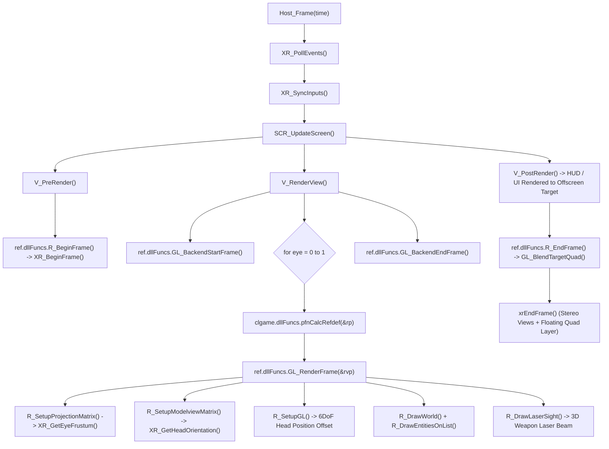

# 🥽 Xash3D VR — Technical Architecture & Port Guide

> **Official Virtual Reality Port for Xash3D FWGS**  
> **Standard:** Canonical Khronos OpenXR 1.0 / 1.1 (Pure C99)  
> **Rendering:** Native Stereo `ref_gl_vr` (GLES 2.0/3.0 & Desktop OpenGL)  
> **Platforms:** Meta Quest Standalone (Quest 1/2/Pro/3/3S / Horizon OS) & Desktop PCVR (Linux Monado / WiVRn / SteamVR)

---

## 1. Vision & Purpose

**Xash3D VR** is the native OpenXR Virtual Reality port for the **Xash3D FWGS** engine, enabling full 6DoF roomscale play of classic **Half-Life (1998)**, expansions (*Opposing Force*, *Blue Shift*), and GoldSrc modifications.

The project is deeply inspired by the pioneering work of **Team Beef** (*Dr. Beef, BaggyG, Bummser*), whose *Lambda1VR* port proved the power of Half-Life on standalone VR headsets. While *Lambda1VR* targeted the original 2019 Oculus Quest using legacy *VrApi*, Xash3D VR is re-architected from the ground up around:
1. **The Khronos OpenXR Standard:** Pure C99 OpenXR implementation without vendor lock-in or proprietary wrappers.
2. **Upstream Xash3D FWGS Purity:** Keeps engine core changes minimal, ensuring seamless GoldSrc mod compatibility, clean code standards, and multiplayer crossplay between VR and Flat players.
3. **Unified Multi-Platform Codebase:** Single codebase running on Desktop PCVR and Android Standalone headsets.

---

## 2. Technical Architecture Overview

```
xash3d-fwgs-vr/
├── engine/platform/openxr/         ← Pure C99 OpenXR platform subsystem
│   ├── xr_core.c / .h              ← Lifecycle, instance, sessions, reference spaces, CVars
│   ├── xr_graphics.c               ← Multi-platform graphics bindings (Linux GLX & Android EGL)
│   ├── xr_swapchain.c / .h         ← Stereo swapchains, pacing, hardware VSync, frustum
│   └── xr_input.c / .h             ← Universal Action Sets, 6DoF tracking, gestures, haptics
├── ref/gl_vr/                      ← Dedicated stereo renderer library (libref_gl_vr.so)
│   ├── gl_rmain.c                  ← Dual viewpass loop, FBO attachment, laser sight
│   ├── gl_studio.c                 ← Decoupled 6DoF weapon viewmodels (aim-pose aligned)
│   ├── gl_frustum.c                ← Asymmetric lens frustum culling
│   └── gl_fbo.c                    ← Dedicated per-eye OpenXR swapchain FBO management
└── android/                        ← Meta Horizon OS modern widescreen launcher (Kotlin)
```

### 2.1 Complete Frame Pipeline



---

## 3. Subsystem Breakdown

### 3.1 OpenXR Core (`engine/platform/openxr/xr_core.c`)
- **Graphics Extensions:** Negotiates `XR_KHR_opengl_enable` on desktop Linux and `XR_KHR_opengl_es_enable` on Android.
- **Reference Spaces:**
  - `XR_REFERENCE_SPACE_TYPE_STAGE`: Preferred roomscale tracking aligned with physical floor and Guardian bounds.
  - `XR_REFERENCE_SPACE_TYPE_LOCAL`: Seamless fallback for sitting/standing play without camera drift.
  - `XR_REFERENCE_SPACE_TYPE_VIEW`: Head-relative reference space used for floating HUD and menus (`z = -1.5m`).

### 3.2 Stereo Swapchains & Optics (`xr_swapchain.c` & `gl_frustum.c`)
- **Hardware Pacing:** Driven by `xrWaitFrame()`, locking framerate directly to physical panel refresh rates (72Hz, 90Hz, 120Hz).
- **Asymmetric Projection Frustum:** Queries per-eye FOV tangents from runtime (`xrLocateViews`) and calculates asymmetric frustum boundaries:
  $$\text{left} = \tan(\text{angleLeft}) \times \text{nearZ}$$
  $$\text{right} = \tan(\text{angleRight}) \times \text{nearZ}$$
  $$\text{bottom} = \tan(\text{angleDown}) \times \text{nearZ}$$
  $$\text{top} = \tan(\text{angleUp}) \times \text{nearZ}$$
- **GL4ES External Texture Bypass:** Uses `gl4es_registerExternalTexture()` and direct hardware `libGLESv2.so` calls to prevent virtualization dummy texture allocation on Qualcomm Adreno TBDR GPUs.

### 3.3 Universal Input & Controller Mechanics (`xr_input.c`)
- **Profiles:** Canonical bindings for Meta Quest Touch (Quest 1/2/Pro/3/3S) and Valve Index Knuckles.
- **Locomotion:**
  - Analog stick deadzone (`0.15`).
  - Snap Turn (`vr_smoothturn 0`, step `vr_snap_angle 45°`) with haptic click; Smooth Turn (`vr_smoothturn 1`, `150°/s`).
  - Movement direction decoupling (`vr_walkdirection`): `0` = HMD gaze direction (default), `1` = Controller direction.
- **Weapon Mechanics & Decoupling:**
  - Weapon viewmodel locked to dominant controller aim pose (`XR_GetPrimaryHandTransform`).
  - Bullet traces and rockets originate along weapon barrel direction in server commands (`cmd->viewangles`).
  - Two-Handed Weapon Stabilizer: Holding offhand grip (`grip > 0.4`) within 12cm–55cm aligns aim along the inter-hand vector.
  - Quick Weapon Switch: Flicking turn stick Up = `invprev`, Down = `invnext` (with debounce and haptic tick).
  - Gestures: Over-the-shoulder crowbar draw (`slot1`), forward reach to interact (`+use`).
- **Left-Handed Mode (`vr_lefthanded 1`):** Swaps weapon hand, laser sight, triggers, and locomotion/turn sticks dynamically.

---

## 4. Console Variables (CVars)

All VR CVars are archived (`FCVAR_ARCHIVE`) and registered early in `Host_Init()`:

| CVar | Default | Values | Description |
| :--- | :---: | :---: | :--- |
| `vr_smoothturn` | `1` | `0`, `1` | `0` = discrete snap turning, `1` = smooth turning |
| `vr_snap_angle` | `45` | `15`–`90` | Angle step in degrees for snap turn mode |
| `vr_walkdirection` | `0` | `0`, `1` | `0` = movement oriented by HMD gaze, `1` = oriented by controller |
| `vr_lasersight` | `1` | `0`, `1` | Real-time 3D red laser beam projected from weapon barrel |
| `vr_headtorch` | `0` | `0`, `1` | `0` = physical off-hand flashlight, `1` = head-mounted flashlight |
| `vr_lefthanded` | `0` | `0`, `1` | `1` = primary weapon held in left hand, sticks/triggers inverted |
| `vr_weapon_pitchadjust` | `0` | `-30`–`+30` | Fine pitch adjustment angle for physical weapon stock alignment |
| `vr_height_adjust` | `0` | `-20`–`+20` | Standing height offset calibration in GoldSrc units |
| `vr_worldscale` | `40.0` | `20.0`–`60.0` | Engine units per real-world meter (default: 40.0) |
| `vr_haptics_enabled` | `1` | `0`, `1` | Haptic vibration feedback on weapon fire, damage, and UI |
| `vr_haptics_intensity` | `1.0` | `0.0`–`2.0` | Global haptic vibration amplitude multiplier |
| `vr_pointer_hud` | `1` | `0`, `1` | 3D in-headset laser pointer for menu and HUD interaction |

---

## 5. Build & Testing Workflows

### 5.1 Desktop PCVR (Linux Monado / WiVRn / SteamVR)
```bash
# Configure and build
./waf configure --enable-openxr --enable-gl-vr
./waf build
./waf install --destdir=./out

# Run automated Monado headless simulation (bounded 15s test)
./scripts/test_simulated_monado.sh crossfire

# Run directly on PCVR headset
cd out && ./xash3d -dev 1 -ref gl_vr +map c1a0
```

### 5.2 Meta Quest Standalone (Android arm64)
```bash
# Build standalone APK
./scripts/build_quest_apk.sh

# Install on connected Quest
adb install -r out/xash3d-vr-quest.apk

# Check headset battery and thermals
./scripts/quest_battery.sh

# Run automated test with pixel dump validation
./scripts/test_quest_auto.sh 25 crossfire
```
