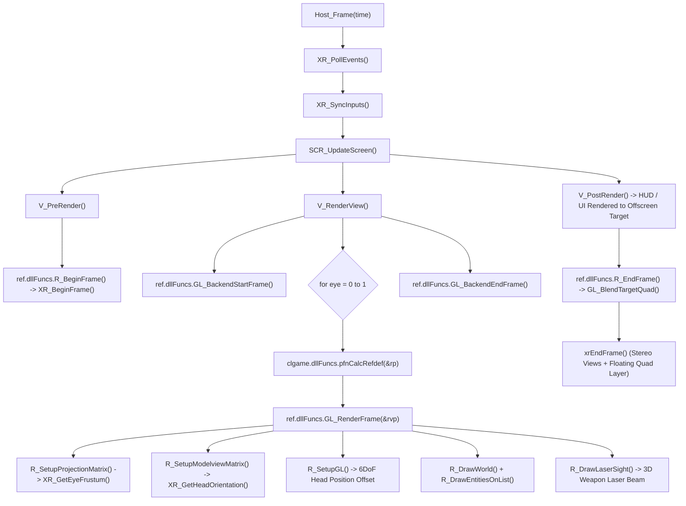

# 🥽 Xash3D VR — Technical Architecture & Port Guide

> **Official Virtual Reality Port for Xash3D FWGS**  
> **Standard:** Canonical Khronos OpenXR 1.0 / 1.1 (Pure C99)  
> **Rendering:** Native Stereo `ref_gl_vr` (GLES 2.0/3.0 & Desktop OpenGL)  
> **Platforms:** Meta Quest Standalone (Quest 1/2/Pro/3/3S / Horizon OS) & Desktop PCVR (Linux Monado / WiVRn / SteamVR)

---

## 1. Vision & Purpose

**Xash3D VR** is the native OpenXR Virtual Reality port for the **Xash3D FWGS** engine, enabling full 6DoF roomscale play of classic **Half-Life (1998)**, expansions (*Opposing Force*, *Blue Shift*), and GoldSrc modifications.

The project is deeply inspired by the pioneering work of **Team Beef** (*Dr. Beef, BaggyG, Bummser*), whose *Lambda1VR* port proved the power of Half-Life on standalone VR headsets. While *Lambda1VR* targeted the original 2019 Oculus Quest using legacy *VrApi*, Xash3D VR is re-architected from the ground up around:
1. **The Khronos OpenXR Standard:** Pure C99 OpenXR implementation without vendor lock-in or proprietary wrappers.
2. **Upstream Xash3D FWGS Purity:** Keeps engine core changes minimal, ensuring seamless GoldSrc mod compatibility, clean code standards, and multiplayer crossplay between VR and Flat players.
3. **Unified Multi-Platform Codebase:** Single codebase running on Desktop PCVR and Android Standalone headsets.

---

## 2. Technical Architecture Overview

```
xash3d-fwgs-vr/
├── engine/platform/openxr/         ← Pure C99 OpenXR platform subsystem
│   ├── xr_core.c / .h              ← Lifecycle, instance, sessions, reference spaces, CVars
│   ├── xr_graphics.c               ← Multi-platform graphics bindings (Linux GLX & Android EGL)
│   ├── xr_swapchain.c / .h         ← Stereo swapchains, pacing, hardware VSync, frustum
│   └── xr_input.c / .h             ← Universal Action Sets, 6DoF tracking, gestures, haptics
├── ref/gl_vr/                      ← Dedicated stereo renderer library (libref_gl_vr.so)
│   ├── gl_rmain.c                  ← Dual viewpass loop, FBO attachment, laser sight
│   ├── gl_studio.c                 ← Decoupled 6DoF weapon viewmodels (aim-pose aligned)
│   ├── gl_frustum.c                ← Asymmetric lens frustum culling
│   └── gl_fbo.c                    ← Dedicated per-eye OpenXR swapchain FBO management
└── android/                        ← Meta Horizon OS modern widescreen launcher (Kotlin)
```

### 2.1 Complete Frame Pipeline



---

## 3. Subsystem Breakdown

### 3.1 OpenXR Core (`engine/platform/openxr/xr_core.c`)
- **Graphics Extensions:** Negotiates `XR_KHR_opengl_enable` on desktop Linux and `XR_KHR_opengl_es_enable` on Android.
- **Reference Spaces:**
  - `XR_REFERENCE_SPACE_TYPE_STAGE`: Preferred roomscale tracking aligned with physical floor and Guardian bounds.
  - `XR_REFERENCE_SPACE_TYPE_LOCAL`: Seamless fallback for sitting/standing play without camera drift.
  - `XR_REFERENCE_SPACE_TYPE_VIEW`: Head-relative reference space used for floating HUD and menus (`z = -1.5m`).

### 3.2 Stereo Swapchains & Optics (`xr_swapchain.c` & `gl_frustum.c`)
- **Hardware Pacing:** Driven by `xrWaitFrame()`, locking framerate directly to physical panel refresh rates (72Hz, 90Hz, 120Hz).
- **Asymmetric Projection Frustum:** Queries per-eye FOV tangents from runtime (`xrLocateViews`) and calculates asymmetric frustum boundaries:
  $$\text{left} = \tan(\text{angleLeft}) \times \text{nearZ}$$
  $$\text{right} = \tan(\text{angleRight}) \times \text{nearZ}$$
  $$\text{bottom} = \tan(\text{angleDown}) \times \text{nearZ}$$
  $$\text{top} = \tan(\text{angleUp}) \times \text{nearZ}$$
- **GL4ES External Texture Bypass:** Uses `gl4es_registerExternalTexture()` and direct hardware `libGLESv2.so` calls to prevent virtualization dummy texture allocation on Qualcomm Adreno TBDR GPUs.

### 3.3 Universal Input & Controller Mechanics (`xr_input.c`)
- **Profiles:** Canonical bindings for Meta Quest Touch (Quest 1/2/Pro/3/3S) and Valve Index Knuckles.
- **Unified Half-Life 2: VR Mod Controller Layout:**
  - **Right Controller:**
    - Button A: Reload (`+reload`).
    - Button B: Secondary Fire (`+attack2`, MP5 grenade launcher, Shotgun double blast) or Flashlight (configurable via `vr_button_b_action`).
    - Analog Stick: Smooth turn (`vr_smoothturn 1`) or Snap turn (`vr_smoothturn 0`, step `vr_snap_angle 45°`). Click = Sprint (`+speed`).
    - Trigger: Primary Fire (`+attack`) / Menu pointer click (`K_MOUSE1`).
    - Grip: Weapon hold / Two-handed stabilizer when secondary.
  - **Left Controller:**
    - Button X: Jump (`+jump`).
    - Button Y: Use / Interact (`+use`).
    - Analog Stick: 2D Locomotion (walk/strafe). Direction decoupled via `vr_walkdirection` (`0` = HMD gaze, `1` = controller aim). Click = Crouch (`+duck`).
    - Trigger: Sprint / Alt-fire when stabilized / Menu pointer click.
    - Grip: Off-hand stabilizer grip (`grip > 0.55`).
  - **Universal Menu Button:** Toggles in-game menu / floating Quad UI (`K_ESCAPE`).
- **Weapon Mechanics, Ballistics & Decoupling:**
  - Weapon viewmodel locked to dominant controller aim pose (`XR_GetPrimaryHandTransform`).
  - Server-side bullet traces and rockets emerge from physical 3D muzzle (`pev->vuser1`).
  - Two-Handed Weapon Stabilizer (`vr_twohanded`): Holding offhand grip (`grip > 0.55`, release `< 0.35`) with forward gating (5cm to 60cm), separation (12cm to 65cm), and soft asymptotic clamp (`softDev`) provides 50% tighter bullet spread (`pev->vuser4.x`).
  - Physical Grenade & Snark Momentum: Throw velocity inherits 6DoF hand swing momentum (`pev->vuser3 * 1.25f`).
  - 6DoF Tripmines: Wall/floor mounting trace follows controller orientation (`pev->vuser2`).
  - Quick Weapon Switch: Flicking turn stick Up = `invprev`, Down = `invnext` (with debounce and haptic tick).
  - Physical Gestures:
    - Head-mounted flashlight toggle via temple touch gesture (`vr_headtorch 1`).
    - Over-the-shoulder crowbar draw (`slot1`).
    - Proximity optical scope (`vr_proximity_scope 1`): Zoom (`+alt1`) engages automatically within 15cm of eye.
    - Touch-to-use (`vr_gesture_use 1`): Physical forward reach triggers `+use`.
    - Physical melee swing (`vr_melee_swing 1`): Rapid crowbar swing attacks enemies.
- **Left-Handed Mode (`vr_lefthanded 1`):** Swaps weapon hand, laser sight, triggers, and locomotion/turn sticks dynamically.

---

## 4. Console Variables (CVars)

All VR CVars are archived (`FCVAR_ARCHIVE`) and registered early in `Host_Init()` via `XR_RegisterCVars()`:

| CVar | Default | Values | Description |
| :--- | :---: | :---: | :--- |
| **Locomotion & Comfort** | | | |
| `vr_smoothturn` | `1`* | `0`, `1` | `0` = discrete snap turning, `1` = smooth turning (*Launcher defaults to `0` for comfort) |
| `vr_snap_angle` | `45` | `15`–`90` | Angle step in degrees for snap turn mode |
| `vr_walkdirection` | `0` | `0`, `1` | `0` = movement oriented by HMD gaze, `1` = oriented by controller |
| `vr_physical_crouch` | `1` | `0`, `1` | Physical roomscale crouching (triggers `IN_DUCK` when squatting $\ge 28\text{cm}$) |
| `vr_height_adjust` | `0` | `-20`–`+20` | Standing height offset calibration in GoldSrc units |
| `vr_worldscale` | `40.0` | `20.0`–`60.0` | Engine units per real-world meter (default: 40.0) |
| **Weapons & Combat** | | | |
| `vr_lasersight` | `1` | `0`, `1` | Real-time 3D red laser beam projected from weapon barrel with impact marker |
| `vr_headtorch` | `1` | `0`, `1` | `1` = head-mounted flashlight with temple gesture (HL2:VR), `0` = off-hand flashlight |
| `vr_twohanded` | `0` | `0`, `1` | Enable two-handed weapon grip stabilization with soft clamp |
| `vr_lefthanded` | `0` | `0`, `1` | `1` = primary weapon held in left hand, sticks/triggers inverted |
| `vr_weapon_pitchadjust` | `0`* | `-30`–`+30` | Fine pitch adjustment angle for physical weapon alignment (*Launcher defaults to `10`) |
| `vr_proximity_scope` | `1` | `0`, `1` | Natural optical zoom on Crossbow/Magnum when weapon is brought within 15cm of eye |
| `vr_melee_swing` | `1` | `0`, `1` | Physical arm swing motion to trigger Crowbar melee attacks |
| `vr_button_b_action` | `0` | `0`, `1` | Right B button action: `0` = Alt-Fire (`+attack2`, HL2:VR default), `1` = Flashlight |
| `vr_weapon_offset_forward`| `-10.0` | float | Weapon grip forward offset in GoldSrc units |
| `vr_calibration_stick` | `0` | `0`, `1` | Real-time 6DoF weapon offset & angle calibration via thumbstick (Team Beef: L/R=axis, U/D=adjust) |
| **Immersion, Audio & Presence** | | | |
| `vr_hide_arms` | `1` | `0`, `1`, `2` | `1` = 3D hands only (culls rigid 1998 flat arms), `2` = floating weapons, `0` = original mesh |
| `vr_audio_hrtf` | `1` | `0`, `1` | 3D binaural HRTF spatial audio with pinna shadowing and 6DoF listener tracking |
| `vr_haptics_enabled` | `1` | `0`, `1` | OpenXR haptic vibration feedback on weapon fire, damage, and UI |
| `vr_haptics_intensity` | `1.0` | `0.0`–`2.0` | Global haptic vibration amplitude multiplier |
| `vr_finger_curling` | `1` | `0`, `1` | Procedural finger curling driven by controller analog trigger/grip axes |
| `vr_finger_curl_scale` | `1.0` | `0.1`–`2.0` | Multiplier for procedural finger curling angle |
| `vr_gesture_use` | `1` | `0`, `1` | Touch-to-use gesture when extending free hand towards buttons and interactive objects |
| `vr_offhand_render` | `0` | `0`, `1` | Render secondary 6DoF off-hand presence when not holding weapon |
| **Spatial UI & Debug** | | | |
| `vr_pointer_hud` | `1` | `0`, `1` | Beat Saber-style 3D dual alternating laser pointers for menus and UI |
| `vr_menu_distance` | `1.5` | `1.0`–`3.5` | Distance in meters of floating 2D menu quad canvas in head space |
| `vr_menu_scale` | `1.4` | `1.0`–`3.0` | Width in meters of floating 2D menu quad canvas |
| `vr_debug_impacts` | `1` | `0`, `1` | 3D visual markers (crosshairs, tracers, normals) at bullet impact points |

---

## 5. Build & Testing Workflows

### 5.1 Desktop PCVR (Linux Monado / WiVRn / SteamVR)
```bash
# Configure and build
./waf configure --enable-openxr --enable-gl-vr
./waf build
./waf install --destdir=./out

# Run automated Monado comprehensive unit test suite (23 assertion gates, 40s)
./scripts/test_simulated_monado.sh

# Or run custom map simulation in Monado
./scripts/test_simulated_monado.sh crossfire

# Run directly on PCVR headset
cd out && ./xash3d -dev 1 -ref gl_vr +map c1a0
```

### 5.2 Meta Quest Standalone (Android arm64)
```bash
# Build standalone APK
./scripts/build_quest_apk.sh

# Install on connected Quest
adb install -r out/xash3d-vr-quest.apk

# Check headset battery and thermals
./scripts/quest_battery.sh

# Run automated test with pixel dump validation
./scripts/test_quest_auto.sh 25 crossfire
```

### 5.3 Ferramentas MCP & Inteligência de Código (`mcp-tools`)

O fluxo de engenharia do port VR integra ferramentas do Model Context Protocol (MCP) localizadas em `../mcp-tools` para governança, auditoria de código e análise de impacto prévia a refatorações:

- **Repowise:** Análise de call graph, blast radius e rastreamento de símbolos C/C++ sem requisições LLM. Usado para prever quebras ao modificar estruturas de movimentação (`sv_pmove.c`), renderizador (`gl_rmain.c`) ou platform layers (`xr_swapchain.c`).
- **Graphify:** Mapeamento em grafo de conhecimento (AST + semântico), agrupamento em comunidades e visualização interativa do ecossistema engine/OpenXR (`graphify-out/graph.html`).
- **Desloppify:** Scanner rigoroso de código morto, acoplamento e dívida técnica C/C++ vinculado a `build/compile_commands.json`.

```bash
# Verificar status das ferramentas MCP e artefatos de grafo
./scripts/mcp_tools.sh status

# Gerar/atualizar grafo de conhecimento AST do repositório
./scripts/mcp_tools.sh graph

# Analisar código morto e símbolos inacessíveis (Repowise)
./scripts/mcp_tools.sh dead-code

# Executar scanner de higiene e dívida técnica C/C++ (Desloppify)
./scripts/mcp_tools.sh health
```

---

## 6. Documentação Relacionada

- [Caderno de Engenharia & Anotações de Soluções](file:///home/ejs94/Documentos/Repos/xash3d-fwgs-vr/Documentation/vr/ENGINEERING_NOTEBOOK.md) — Soluções próprias vs adaptadas, decisões arquiteturais, telemetria headless, integração OpenXR-CTS e governança MCP.
- [Roadmap & Análise de Problemas](file:///home/ejs94/Documentos/Repos/xash3d-fwgs-vr/Documentation/vr/ROADMAP.md) — Fases 01 a 08, port tracker e histórico de depuração.
- [Arquitetura de Compatibilidade de Mods & Mod Manager](file:///home/ejs94/Documentos/Repos/xash3d-fwgs-vr/Documentation/vr/MOD_COMPATIBILITY_ARCHITECTURE.md) — Sistema de 3 Tiers (Gold, Silver, Bronze), especificações de manifest (`vr_mods.json`), Mod Manager para Quest/PCVR, e protocolos de limpeza de armazenamento.
- [Estratégia de Sincronização Upstream](file:///home/ejs94/Documentos/Repos/xash3d-fwgs-vr/Documentation/vr/UPSTREAM_SYNC_STRATEGY.md) — Política de Selective Cherry-Pick com Janela de Maturação (60-90 dias) e testes em sandbox Monado VR.


