# 🥽 Meta Quest Standalone VR — Diagnostics, Team Beef Comparison & Action Plan

> **Document Status:** Active Engineering Reference  
> **Author:** Antigravity AI Engineering Team  
> **Target Subsystems:** `engine/platform/openxr/`, `ref/gl_vr/`, `android/app/`  
> **Hardware Target:** Meta Quest 3S / Meta Quest Standalone (Horizon OS, Android 12L)  
> **Baseline Reference:** Team Beef *Lambda1VR* (`../Lambda1VR`) & Khronos OpenXR 1.0/1.1 Specification (`../OpenXR-SDK`)

---

## 1. Executive Summary & Purpose

During automated and manual verification of the Xash3D VR Standalone Quest APK (`su.xash.engine.vr.test`), the application installed successfully and passed headless CI checks, but testing on the physical headset resulted in:
1. **Initial Black Screen** with no stereoscopic imagery.
2. **Infinite Loading / Frozen Splash** upon relaunching.

This document compiles the exhaustive root-cause analysis, an architectural comparison against Team Beef's *Lambda1VR*, an audit of the Khronos OpenXR specification, and an actionable roadmap for any incoming AI agent or developer to finalize standalone video output.

---

## 2. Root Cause Analysis: Black Screen & Infinite Loading

Through runtime logcat inspection (`out/evidence/quest_*`), ADB window dumps, and device screencaps (`screencap -p`), three interlocking root causes were identified:

### 2.1 Cause A: `SDLActivity` Window Focus Gate (Infinite Loading)
* **Observed Symptom:** The APK starts, Horizon OS creates an immersive volumetric window (`VolumetricWindowToken`), but `SDL_main -> libxash.so` never executes.
* **Mechanism:**
  In `SDLActivity.java` (upstream SDL2 for Android):
  ```java
  // org/libsdl/app/SDLActivity.java:708
  if (mNextNativeState == NativeState.RESUMED) {
      if (mSurface.mIsSurfaceReady && mHasFocus && mIsResumedCalled) {
          if (mSDLThread == null) {
              mSDLThread = new Thread(new SDLMain(), "SDLThread");
              mSDLThread.start();
          }
      }
  }
  ```
  On Meta Horizon OS, activity launch triggers:
  ```text
  SDL: onWindowFocusChanged(): true
  SDL: onWindowFocusChanged(): false   <-- Transient focus stolen by Horizon OS Shell / Dialog
  SDL: surfaceCreated()
  SDL: surfaceChanged()
  ```
  Because `mSurface.mIsSurfaceReady` is still `false` when `onWindowFocusChanged(true)` is initially delivered, and focus is immediately lost (`mHasFocus = false`), the condition is never satisfied. `mSDLThread` is never spawned, leaving the activity indefinitely waiting on a blank/frozen window.

### 2.2 Cause B: Meta Horizon OS Modal Blocking & Reprojected Dialogs
* **Observed Symptom:** Screen appears completely black with a blue power icon or queues launches indefinitely.
* **Mechanism:**
  Horizon OS displayed the privacy prompt:
  > *"Pressione o botão liga/desliga para habilitar as câmeras e os microfones"*
  
  While this system dialog is active:
  ```text
  SystemUXController: Launch is blocked because: a Reprojected OS dialog is currently showing.
  Caching launch for component su.xash.engine.vr.test/su.xash.engine.XashActivity
  ```
  Horizon OS suspends immersive rendering and freezes incoming client swapchains until the user explicitly dismisses the modal.

### 2.3 Cause C: Headset Standby & Proximity Sensor Automation
* **Observed Symptom:** Headset goes to sleep when removed from face or placed on desk for development; OpenXR returns `xrWaitFrame: returning early due to activity pause`.
* **Mechanism:**
  The Oculus VR Power Manager (`com.oculus.vrpowermanager`) sets `State: STANDBY` and `Virtual proximity state: CLOSE/FAR`. When in standby:
  - OpenXR `XrFrameState.shouldRender` returns `XR_FALSE`.
  - In `xr_swapchain.c`, `if (g_currentFrameState.shouldRender && g_xrEyesAcquired)` is false, so `layerCount = 0` is sent to `xrEndFrame()`, rendering a solid black compositor background.

---

## 3. Deep Architectural Comparison: Team Beef (Lambda1VR) vs. Xash3D VR

A detailed inspection of `../Lambda1VR/Projects/Android/jni/src/Lambda1VR/` revealed critical differences in how Team Beef architected their Quest port versus our tri-platform approach:

```mermaid
flowchart TD
    subgraph Lambda1VR ["Team Beef — Lambda1VR Architecture"]
        L1_ACT["L1VR_SurfaceView.c (Custom Native / SurfaceView)"]
        L1_MSG["surfaceMessageQueue (Explicit Lifecycle IPC)"]
        L1_GL["gl4es (OpenGL 1.4 -> GLES 3.x Translation)"]
        L1_FBO["Per-Swapchain Depth Renderbuffers (1:1 with Color)"]
        L1_LOOP["TBXR_FrameSetup() -> xrWaitFrame() + xrBeginFrame()"]
        L1_ACT --> L1_MSG --> L1_GL --> L1_FBO --> L1_LOOP
    end

    subgraph Xash3D_VR ["Xash3D VR — Current Architecture"]
        X_ACT["SDLActivity / XashActivity (SDL2 Android Framework)"]
        X_CORE["Engine Loop Host_Frame() -> SCR_UpdateScreen()"]
        X_REF["ref_gl_vr (Native GLES 3.x Engine Renderer)"]
        X_FBO["Shared Single Depth Renderbuffer per Eye"]
        X_LOOP["R_RenderFrame() -> XR_WaitFrame() + XR_BeginFrame()"]
        X_ACT --> X_CORE --> X_REF --> X_FBO --> X_LOOP
    end
```



### Detailed Subsystem Breakdown

| Subsystem | Team Beef (*Lambda1VR*) | Our Implementation (*Xash3D VR*) | Khronos OpenXR Specification | Key Difference & Implication |
| :--- | :--- | :--- | :--- | :--- |
| **Android Harness** | Custom `SurfaceView` and native message queue (`L1VR_SurfaceView.c`), bypassing SDL Android lifecycle entirely. | Standard `SDLActivity` subclass (`su.xash.engine.XashActivity`). | Requires `XR_KHR_android_create_instance` with `applicationVM` and `applicationActivity`. | SDL's window focus gate (`mHasFocus`) can deadlock under Horizon OS window manager if focus blinks. |
| **Graphics Translation** | Uses **gl4es** (`initialize_gl4es()`) to translate legacy fixed-function OpenGL 1.4 to GLES 3.x. | Direct native **`ref_gl_vr`** GLES backend (`libref_gl_vr.so`). | Requires `XR_KHR_opengl_es_enable` with `XrGraphicsBindingOpenGLESAndroidKHR`. | Our native backend has significantly lower CPU/GPU overhead, but requires strict GLES state and FBO discipline. |
| **Swapchain FBO Setup** | Allocates an independent depth buffer for **each** swapchain texture: `frameBuffer->DepthBuffers[i]`. Supports multisampling. | Allocates **1 shared depth buffer per eye** (`s_xrEyeDepthRbos[eye]`) and binds it to all swapchain image FBOs. | OpenXR permits both, provided format and dimensions match. | Shared depth buffer is valid, but multiple FBO re-attachments must ensure depth attachments do not cause feedback loops. |
| **Alpha Channel Handling** | Explicitly masks alpha and clears to 1.0: `glColorMask(GL_FALSE, GL_FALSE, GL_FALSE, GL_TRUE); glClearColor(0,0,0,1); glClear(GL_COLOR_BUFFER_BIT); glColorMask(GL_TRUE, GL_TRUE, GL_TRUE, GL_TRUE);` | Normal clear `pglClear(GL_COLOR_BUFFER_BIT \| GL_DEPTH_BUFFER_BIT)`. | Layer flag `XR_COMPOSITION_LAYER_BLEND_TEXTURE_SOURCE_ALPHA_BIT` blends against black compositor if alpha is 0. | If the game renders pixels with alpha = 0.0, the Quest compositor treats them as 100% transparent (black screen)! |
| **Color Space & SRGB** | Disables `GL_FRAMEBUFFER_SRGB` and queries `XR_FB_color_space` (`XR_COLOR_SPACE_REC2020_FB`). | Uses standard `GL_RGBA8` swapchain format. | `GL_RGBA8` or `GL_SRGB8_ALPHA8` are standard formats. | Prevents washed-out colors or gamma mismatches. |
| **Tracking Space** | Creates `XR_REFERENCE_SPACE_TYPE_VIEW` for head and `XR_REFERENCE_SPACE_TYPE_STAGE` for room bounds. | Uses `XR_REFERENCE_SPACE_TYPE_LOCAL`. | Both are standard reference space types. | `LOCAL` is anchored to initial head position; `STAGE` is floor/guardian relative. `LOCAL` is completely valid. |
| **Frustum & Asymmetric FOV** | Calculates: `tan(angle) * nearZ`. Does not use `XrFrustumf` struct directly. | Calculates: `tanf(angle) * nearZ` in `XR_GetEyeFrustum()`. | `XrFrustumf` is a utility struct in OpenXR SDK (`pose`, `fov`, `nearZ`, `farZ`). | Mathematical implementation is **identical and verified**. |

---

## 4. Analysis of `XrFrustumf`

* **Definition in OpenXR SDK (`openxr.h:2188`)**:
  ```c
  typedef struct XrFrustumf {
      XrPosef    pose;
      XrFovf     fov;
      float      nearZ;
      float      farZ;
  } XrFrustumf;
  ```
* **Current Engine Implementation (`engine/platform/openxr/xr_swapchain.c:435`)**:
  ```c
  void XR_GetEyeFrustum( int eye, float nearZ, float farZ, float *left, float *right, float *bottom, float *top )
  {
      *left   = tanf(g_xrViews[eye].fov.angleLeft) * nearZ;
      *right  = tanf(g_xrViews[eye].fov.angleRight) * nearZ;
      *bottom = tanf(g_xrViews[eye].fov.angleDown) * nearZ;
      *top    = tanf(g_xrViews[eye].fov.angleUp) * nearZ;
  }
  ```
* **Renderer Ingestion (`ref/gl_vr/gl_rmain.c:402`)**:
  ```c
  XR_GetEyeFrustum( g_vr_eye, zNear, zFar, &left, &right, &bottom, &top );
  Matrix4x4_CreateProjection( m, right, left, top, bottom, zNear, zFar );
  ```
* **Verdict:** The asymmetric projection mathematics match Khronos specifications and Lambda1VR behavior. The issue is **not** in the frustum calculations.

---

## 5. Action Plan & Next Implementation Steps

Any subsequent agent or engineer working on this repository should execute the following phases:

### Phase 1: Fix the `SDLActivity` Focus Gate in `XashActivity.java`
In `android/app/src/main/java/su/xash/engine/XashActivity.java`:
1. Override `onWindowFocusChanged(boolean hasFocus)`:
   - On Meta Quest / Horizon OS, do not allow a transient `hasFocus == false` during the initial launch phase to prevent `mSDLThread` from spawning once the EGL surface is ready.
   - Alternatively, trigger `handleNativeState()` when `surfaceChanged()` fires, ensuring `mNextNativeState = NativeState.RESUMED` if running in VR mode.

### Phase 2: Framebuffer Alpha & Clear Hardening in `ref/gl_vr/`
In `ref/gl_vr/gl_rmain.c`:
1. Emulate Team Beef's alpha channel guarantee:
   - Before submitting swapchain textures to OpenXR compositor, ensure the alpha channel of the eye FBO is set to `1.0f` so the compositor doesn't blend the rendered frame into transparency.
   - Add explicit `glColorMask(GL_FALSE, GL_FALSE, GL_FALSE, GL_TRUE); glClearColor(0,0,0,1); glClear(GL_COLOR_BUFFER_BIT); glColorMask(GL_TRUE, GL_TRUE, GL_TRUE, GL_TRUE);` at the end of each eye pass.

### Phase 3: OpenXR Frame Loop Recovery for Standby
In `engine/platform/openxr/xr_swapchain.c`:
1. If `g_currentFrameState.shouldRender == XR_FALSE`, still execute the frame loop with `layerCount = 0` as required by Khronos:
   ```c
   if (!g_currentFrameState.shouldRender) {
       endInfo.layerCount = 0;
       endInfo.layers = NULL;
       xrEndFrame(g_xrSession, &endInfo);
       return;
   }
   ```
   This prevents the OpenXR runtime from stalling when the user lifts the headset momentarily.

### Phase 4: Headset Automation & Testing Tooling
1. Always run `./scripts/quest_proximity.sh disable` before testing to bypass proximity sensor sleep:
   ```bash
   ./scripts/quest_proximity.sh disable
   ```
2. Verify Quest display state via:
   ```bash
   ./scripts/quest_proximity.sh status
   ```
3. Run automated verification:
   ```bash
   ./scripts/test_quest_auto.sh 35 crossfire
   ```
4. Check device screen interactively via:
   ```bash
   adb exec-out screencap -p > screen.png
   ```

---

## 6. Key File Locations

- **Quest Proximity Script:** [`scripts/quest_proximity.sh`](scripts/quest_proximity.sh)
- **Quest Automated Test:** [`scripts/test_quest_auto.sh`](scripts/test_quest_auto.sh)
- **OpenXR Core:** [`engine/platform/openxr/xr_core.c`](engine/platform/openxr/xr_core.c)
- **OpenXR Swapchain & Loop:** [`engine/platform/openxr/xr_swapchain.c`](engine/platform/openxr/xr_swapchain.c)
- **Stereo Renderer:** [`ref/gl_vr/gl_rmain.c`](ref/gl_vr/gl_rmain.c)
- **Android Harness:** [`android/app/src/main/java/su/xash/engine/XashActivity.java`](android/app/src/main/java/su/xash/engine/XashActivity.java)
- **Team Beef Reference:** [`../Lambda1VR/Projects/Android/jni/src/Lambda1VR/TBXR_Common.c`](../Lambda1VR/Projects/Android/jni/src/Lambda1VR/TBXR_Common.c)
