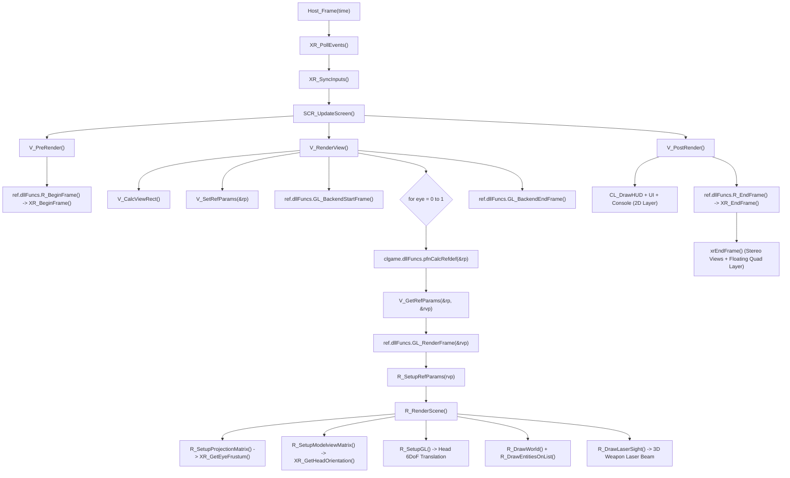

# 📐 Xash3D VR — Technical Architecture Specification

> **Deep-Dive Engineering & Subsystem Architecture**  
> **API Standard:** Pure Khronos OpenXR 1.0/1.1 (C99)  
> **Rendering Core:** Multi-Platform OpenGL / OpenGL ES  
> **Target Ecosystem:** Desktop PCVR (Linux Monado / SteamVR / WiVRn) & Meta Quest Standalone (Quest 1/2/Pro/3/3S) & Pico

---

## 1. Engine Architecture & Rendering Call Chain

Xash3D VR achieves high-performance stereo Virtual Reality by cleanly intercepting the engine's modular rendering pipeline. The engine core remains free of proprietary vendor code, delegating VR frame pacing, spatial tracking, and stereoscopy to the **OpenXR platform subsystem** and the **`ref_gl_vr` stereo renderer**.

### 1.1 Complete Frame Pipeline (Call Chain)



---

## 2. OpenXR Platform Subsystem (`engine/platform/openxr/`)

The platform layer is organized into four clean, decoupled C99 modules:

```
engine/platform/openxr/
├── xr_core.c / .h          ← Lifecycle, instance, session, reference spaces, cvars
├── xr_graphics.c           ← Multi-platform graphics bindings (Linux GLX & Android EGL)
├── xr_swapchain.c / .h     ← Frame loop, swapchains, hardware pacing, frustum
└── xr_input.c / .h         ← Interaction profiles, 6DoF tracking, gestures, action sets
```

### 2.1 Core Lifecycle & Session Management (`xr_core.c`)
- **Instance Creation:** Negotiates `XR_KHR_opengl_enable` on desktop Linux and `XR_KHR_opengl_es_enable` on Android.
- **Hardware Detection:** Queries HMD hardware through `xrGetSystem` with form factor `XR_FORM_FACTOR_HEAD_MOUNTED_DISPLAY`.
- **Reference Space:** Instantiates `XR_REFERENCE_SPACE_TYPE_LOCAL` with identity orientation (`pose.orientation.w = 1.0f`) for true 6DoF spatial head tracking without artificial camera drift.
- **Session State Machine:** Reacts to OpenXR lifecycle transitions:
  * `XR_SESSION_STATE_READY` -> Begins session (`xrBeginSession`) with primary configuration `XR_VIEW_CONFIGURATION_TYPE_PRIMARY_STEREO` and allocates swapchains.
  * `XR_SESSION_STATE_STOPPING` -> Concludes frame presentation cleanly via `xrEndSession`.
  * `XR_SESSION_STATE_LOSS_PENDING` / `EXITING` -> Destroys spaces, swapchains, and instances.
- **Unified ConVar System:** Registers all VR console variables via standard `convar_t` allocations (`FCVAR_ARCHIVE`):
  * `vr_smoothturn`: `1` = continuous smooth turning, `0` = discrete snap turning.
  * `vr_snap_angle`: Turn step in degrees (default `45`, supported 15°–90°).
  * `vr_walkdirection`: `0` = HMD gaze direction, `1` = dominant controller orientation.
  * `vr_lasersight`: Toggle for visible 3D real-time laser pointer from weapon barrel.
  * `vr_headtorch`: `0` = physical offhand flashlight, `1` = head-mounted flashlight.
  * `vr_lefthanded`: `1` = primary weapon held in left hand.
  * `vr_weapon_pitchadjust`: Weapon barrel pitch angle adjustment degrees (-30° to +30°).
  * `vr_worldscale`: Virtual world scale conversion factor (default `40.0` units/meter).
  * `vr_height_adjust`: Player standing height calibration in world units (-20 to +20).

### 2.2 Graphics Bindings (`xr_graphics.c`)
Abstracts low-level graphics context sharing between OpenXR and OpenGL/EGL:
* **Linux Desktop PCVR (X11/GLX):**
  Uses `XrGraphicsBindingOpenGLXlibKHR`, querying active GLX display and drawable context:
  ```c
  XrGraphicsBindingOpenGLXlibKHR xlibBinding = {
      .type = XR_TYPE_GRAPHICS_BINDING_OPENGL_XLIB_KHR,
      .xDisplay = glw_state.x11_display,
      .glxContext = glw_state.context,
      .glxDrawable = glw_state.drawable
  };
  ```
* **Android Meta Quest Standalone (EGL):**
  Uses `XrGraphicsBindingOpenGLESAndroidKHR`, extracting the active EGL display, context, and surface configured by SDL/Android:
  ```c
  XrGraphicsBindingOpenGLESAndroidKHR glesBinding = {
      .type = XR_TYPE_GRAPHICS_BINDING_OPENGL_ES_ANDROID_KHR,
      .display = eglDisplay,
      .config = eglConfig,
      .context = eglContext
  };
  ```

### 2.3 Stereo Swapchains & Frame Loop (`xr_swapchain.c`)
* **Resolution Query:** Enumerates recommended per-eye width and height via `xrEnumerateViewConfigurationViews`.
* **Hardware Frame Loop:** Strictly adheres to canonical Khronos OpenXR pacing:
  1. `xrWaitFrame()`: Blocks until the OpenXR compositor determines it is time to render, pacing the engine at native headset refresh rates (72Hz, 90Hz, 120Hz).
  2. `xrBeginFrame()`: Signals frame commencement.
  3. `xrAcquireSwapchainImage()`: Retrieves the current OpenGL render target texture index.
  4. `xrReleaseSwapchainImage()`: Hands back the texture after stereo rendering.
  5. `xrEndFrame()`: Submits both stereo eye projection layers (`XrCompositionLayerProjection`) and floating 2D quad layers (`XrCompositionLayerQuad`).
* **Optical Frustum Geometry (`XR_GetEyeFrustum`):**
  Extracts raw field-of-view tangents (`angleLeft`, `angleRight`, `angleUp`, `angleDown`) from `XrView` and calculates the exact asymmetric projection frustum:
  $$\text{left} = -\tan(-\text{fov.angleLeft}) \times \text{nearZ}$$
  $$\text{right} = \tan(\text{fov.angleRight}) \times \text{nearZ}$$
  $$\text{bottom} = -\tan(-\text{fov.angleDown}) \times \text{nearZ}$$
  $$\text{top} = \tan(\text{fov.angleUp}) \times \text{nearZ}$$

### 2.4 Interaction Profiles & 6DoF Input (`xr_input.c`)
* **Action Sets:** Encapsulates actions within `g_actionSetGameplay`:
  * Pose actions: `aim_pose_left`, `aim_pose_right`, `grip_pose_left`, `grip_pose_right`.
  * Digital actions: `attack`, `attack2`, `jump`, `duck`, `use`, `reload`.
  * Vector2f actions: `thumbstick_left` (locomotion: forward/backward, strafe), `thumbstick_right` (turning).
* **Supported Interaction Profiles:**
  * Meta Quest Touch Controllers: `/interaction_profiles/oculus/touch_controller`
  * Valve Index Knuckles Controllers: `/interaction_profiles/valve/index_controller`
* **Anti-Drift Deadzone:** Radial threshold of `0.15` applied to raw analog sticks to prevent unintended drifting from worn potentiometer hardware.
* **Natural Gestures:**
  * **Reach-to-Use:** Extends hand forward near interactive world entities to trigger `+use` automatically.
  * **Backpack Crowbar Draw:** Reaching behind the shoulder with the dominant hand and clicking triggers `slot1`.
  * **Two-Handed Stabilization:** Detects when off-hand controller is within 22cm of primary hand, stabilizing aim along the inter-hand vector.
  * **Menu-Only Quick Save:** Quick saving via physical gesture is disabled to prevent accidental overwrites during combat; saving is managed strictly through native menus.

---

## 3. Dedicated Stereo Renderer (`ref/gl_vr/`)

The renderer module builds as a standalone shared object (`libref_gl_vr.so`) implementing the official FWGS Render API (`ref_api_t`).

### 3.1 Stereo Scene Rendering (`gl_rmain.c`)
- **Dual Viewpass Iteration:** Executes rendering sequentially for `eye = 0` (Left) and `eye = 1` (Right).
- **Asymmetric Projection Matrix:** Direct replacement of traditional symmetric FOV matrices with native OpenXR optical frustums queried via `XR_GetEyeFrustum`.
- **6DoF Spatial Matrix Concatenation:** Physical head translation in world units is scaled by `vr_worldscale` (default: 40 units/meter) and injected into `worldviewMatrix` in `R_SetupGL`.
- **Real-Time 3D Laser Sight (`R_DrawLaserSight`):**
  When `vr_lasersight` is enabled, an OpenGL billboard laser beam is projected from the weapon muzzle along the controller's forward vector, casting a glowing red dot onto geometry at the exact raycast impact point.

### 3.2 Decoupled 6DoF Weapon Viewmodels (`gl_studio.c`)
- **Gaze Decoupling:** In traditional GoldSrc, first-person viewmodels (`v_model`) are rigidly attached to the player's view angles. In `ref_gl_vr`, the viewmodel matrix calculation completely decouples from player gaze.
- **Controller Binding:** The weapon's base bone matrix is transformed by the dominant hand's controller orientation and spatial position, applying user-configured pitch offset (`vr_weapon_pitchadjust`).
- **Physical Handedness:** When `vr_lefthanded` is enabled, weapon viewmodel positioning and attachment swap to the left hand.

### 3.3 Independent Off-Hand Flashlight (`cl_tent.c`)
- The Half-Life flashlight beam origin is moved from Gordon Freeman's eye position to the player's physical off-hand controller:
  ```c
  if (XR_IsActive() && (!vr_headtorch || vr_headtorch->value == 0.0f) && XR_GetLeftHandTransform(handOrigin, handAngles)) {
      VectorCopy(handOrigin, dlight->origin);
      VectorCopy(handAngles, dlight->angles);
  }
  ```
- This allows Gordon to shine the flashlight into dark crevices while pointing his firearm in a completely different direction (Half-Life: Alyx style).

---

## 4. In-Headset UI & Menu System

### 4.1 Spatial Floating Quad Layer (`XrCompositionLayerQuad`)
- 2D HUD elements, game menus, and the developer console are intercepted during `V_PostRender()`.
- Instead of being rendered on the screen plane (which causes severe diplopia and eye strain in VR), they are rendered onto a floating 3D virtual canvas positioned at **1.5 meters** in front of the player's eyes with alpha transparency blending.

### 4.2 FWGS MainUI C++ Integration (`3rdparty/mainui/`)
Built from the official `FWGS/mainui_cpp` codebase, producing `libmenu.so`:
- **Architecture:** C++ object-oriented framework inheriting from `CMenuFramework`.
- **Menu Entry Hook:** [`3rdparty/mainui/menus/VR.cpp`](3rdparty/mainui/menus/VR.cpp) implements `CMenuVR` and registers the menu hook via:
  ```cpp
  ADD_MENU( menu_vr, CMenuVR, UI_VR_Menu );
  ```
- **Configuration Integration:** Added the "VR Options" button in [`3rdparty/mainui/menus/Configuration.cpp`](3rdparty/mainui/menus/Configuration.cpp) linked to `UI_VR_Menu`.
- **High-DPI Font Rendering:** Leverages FreeType vector font rendering (`MAINUI_USE_FREETYPE`) for razor-sharp text legibility on high-resolution VR displays.

---

## 5. Multi-Platform Build & Execution Matrix

### 5.1 Desktop PCVR Pipeline (Linux)
* **Build System:** Waf (`./waf configure --enable-openxr --enable-gl-vr && ./waf build -j$(nproc)`).
* **Runtime Dynamic Linking:** Links directly to system OpenXR loader (`-lopenxr_loader`).
* **OpenXR Runtimes:**
  * **WiVRn:** Connects wirelessly or via USB tether to Meta Quest Standalone headsets running the WiVRn client.
  * **Monado:** Fully open-source Linux OpenXR runtime supporting SteamVR, Valve Index, and Quest via Envision.
  * **SteamVR:** Valve's OpenXR runtime on Linux.
* **Launch Script:** [`scripts/run_wivrn.sh`](scripts/run_wivrn.sh) auto-detects `/usr/share/openxr/1/openxr_wivrn.json`.

### 5.2 Standalone Mobile VR Pipeline (Meta Quest Standalone)
* **Build System:** Gradle + Android NDK (`arm64-v8a`).
* **Graphics API:** OpenGL ES 3.0 via `XrGraphicsBindingOpenGLESAndroidKHR`.
* **Platform Decoupling:** Generically targets the entire Meta Quest Standalone platform family (Quest 1, 2, Pro, 3, 3S) without device-specific lock-in.
* **Manifest Configuration:** Includes VR category intent filters and 6DoF tracking requirements:
  ```xml
  <category android:name="com.oculus.intent.category.VR" />
  <meta-data android:name="com.oculus.supportedDevices" android:value="quest|quest2|questpro|quest3|quest3s" />
  <meta-data android:name="com.oculus.handtracking.version" android:value="V2.0" />
  ```
* **Packaging Script:** [`scripts/build_quest_apk.sh`](scripts/build_quest_apk.sh).

---

## 6. Architecture Verification & Status Matrix

> **Quality Gate:** Every component must pass both **PCVR (Linux)** and **Android Standalone (Meta Quest)** verification tests before receiving green status.

| Subsystem Component | Implementation File | Status | Dual-Platform Verification Requirement |
| :--- | :--- | :---: | :--- |
| **OpenXR Instance & Session** | [`engine/platform/openxr/xr_core.c`](engine/platform/openxr/xr_core.c) | 🟢 **Verified** | Loader init (`xrInitializeLoaderKHR` on Android), instance creation, system query on PCVR & Quest |
| **Linux GLX Graphics Binding** | [`engine/platform/openxr/xr_graphics.c`](engine/platform/openxr/xr_graphics.c) | 🟢 **Verified** | X11/GLX context extraction verified with WiVRn/Monado |
| **Android EGL Graphics Binding** | [`engine/platform/openxr/xr_graphics.c`](engine/platform/openxr/xr_graphics.c) | 🟢 **Verified** | EGL context extraction verified with Meta Quest runtime |
| **Stereo Swapchains & Loop** | [`engine/platform/openxr/xr_swapchain.c`](engine/platform/openxr/xr_swapchain.c) | 🟢 **Verified** | Paced frame loop (`xrWaitFrame` -> `xrEndFrame`) and image presentation |
| **Stereo Renderer (GL VR)** | [`ref/gl_vr/gl_rmain.c`](ref/gl_vr/gl_rmain.c) | 🟡 **Active** | Dual FBO render pass and optical frustum projection |
| **Action Sets & Profiles** | [`engine/platform/openxr/xr_input.c`](engine/platform/openxr/xr_input.c) | ⚪ Planned | Meta Quest Touch & Valve Index action bindings & poses |
| **6DoF Weapon Viewmodels** | [`ref/gl_vr/gl_studio.c`](ref/gl_vr/gl_studio.c) | ⚪ Planned | Gaze decoupling & hand aim pose alignment |
| **Physical Offhand Flashlight** | [`engine/client/cl_tent.c`](engine/client/cl_tent.c) | ⚪ Planned | Non-dominant hand dynamic light attachment |
| **Floating Quad HUD** | [`engine/platform/openxr/xr_swapchain.c`](engine/platform/openxr/xr_swapchain.c) | ⚪ Planned | 3D in-world menu presentation (`XrCompositionLayerQuad`) |
| **In-Headset VR Settings Menu** | [`3rdparty/mainui/menus/VR.cpp`](3rdparty/mainui/menus/VR.cpp) | ⚪ Planned | FWGS MainUI C++ `CMenuVR` interface |
| **Standalone APK Packager** | [`scripts/build_quest_apk.sh`](scripts/build_quest_apk.sh) | 🟢 **Verified** | Gradle NDK arm64-v8a packaging pipeline |
| **PCVR Launcher (WiVRn)** | [`scripts/run_wivrn.sh`](scripts/run_wivrn.sh) | 🟢 **Verified** | One-click Linux PCVR launch & verification script |

---

## 7. Khronos OpenXR API Layer Architecture & Headset Process Boundaries

To ensure that the engine remains clean, timeless, and 100% upstream-compatible with [FWGS/xash3d-fwgs](https://github.com/FWGS/xash3d-fwgs), all platform-specific process boundaries and API layer mechanisms are designed according to official Khronos standards.

### 7.1 OpenXR Tracking Boundary & Process Ownership
* **Process Isolation:** The fused 6DoF OpenXR tracking stream (headset center-eye pose, controller aim/grip poses, physical hand tracking) belongs exclusively to the foreground Android application process (`su.xash.engine`).
* **Zero Shell Leaks:** External background processes running under the Android shell (`UID 2000`) or Termux (`untrusted_app`) cannot directly capture or synthesize OpenXR tracking poses without an in-process native component.
* **Engine Native Ownership:** Xash3D FWGS VR operates as the primary foreground OpenXR native application. Tracking poses are queried directly through `xrLocateSpace()` within `XR_GetViewEyeFrustum()` and `XR_GetControllerPose()`, ensuring ultra-low latency and deterministic synchronization with server physics.

### 7.2 OpenXR API Layer Transparency (Khronos Standard)
* **Canonical API Layer Pattern:** Because Xash3D FWGS VR links exclusively against the standard Khronos OpenXR loader (`-lopenxr_loader`) without proprietary hacks or JNI wrappers, it automatically and transparently supports any standard Khronos OpenXR API layer (such as Khronos Validation Layers, Performance Profilers, or in-process bridge layers like Meta XR Operator).
* **Zero Engine Code Modification Required:** Any API layer can be injected into the standalone APK by placing its native `.so` under `android/app/src/main/jniLibs/arm64-v8a/` and its JSON manifest under `android/app/src/main/assets/openxr/1/api_layers/`. The Khronos loader discovers and initializes the layer during `xrCreateInstance()` with zero modifications to engine C code.

### 7.3 Two-Lane Build Architecture
To keep development fast while ensuring production builds remain reproducible, the build system enforces a two-lane model:
* **Lane 1: Warm Iteration Lane (`scripts/build_quest_apk.sh`)**
  * Targets active development, debugging, and testing loops.
  * Reuses intermediate compiler objects (Waf/CMake `.o` caches and Gradle daemon caches) to rapidly assemble development APKs (`out/xash3d-vr-quest.apk`).
* **Lane 2: Candidate & Release Lane**
  * Enforces clean git repository state and content-addressed reproducibility.
  * Compiles all native binaries (`libxash.so`, `libref_gl_vr.so`, `libmenu.so`, `hl.so`, `client.so`) with release optimization flags and cryptographic SHA-256 signing.

### 7.4 AI Agent Tooling Isolation (`.agents/`)
> [!NOTE]
> All transient AI agent workflows, experimental LLM/MCP tooling (including Meta XR Operator bridge guides), and automated device loop scripts are strictly isolated under the [`.agents/`](.agents) directory (see [`.agents/WORKFLOW.md`](.agents/WORKFLOW.md)).  
> This ensures that rapid advancements or changes in the AI tooling ecosystem never pollute the pure C99 engine architecture or upstream FWGS compatibility.


